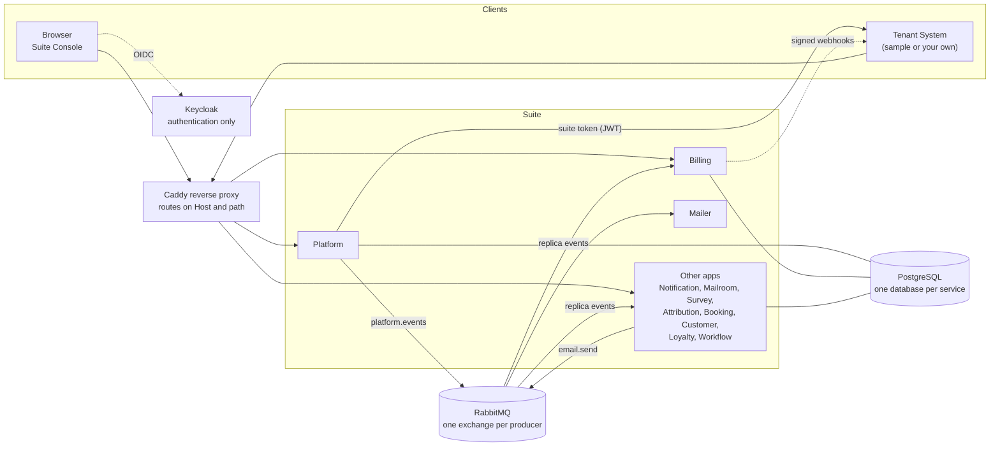

# TenancyKit

TenancyKit is a multi-tenant SaaS suite. One **Platform** service owns identity, tenancy, access and app entitlement.
Every **app** of the suite (Billing, Notification, Mailroom, Survey, Attribution, Booking, Customer, Loyalty, Workflow)
owns its own business data in its own database and enforces the access Platform granted it. A **Sample Tenant System**
proves that an outside system can integrate with the suite using only REST, signed tokens and signed webhooks.

Many Tenants share the one Platform while keeping independent data, users, integration configuration and billing
operations. A new business app joins the suite by adding a build, a permission catalog, an app code and a proxy route;
Platform and the other apps stay unchanged.

Full documentation lives in [docs/](docs/README.md). This file is the entry point: what is here, how to run it, how to
build and verify it.

## Contents

- [The suite at a glance](#the-suite-at-a-glance)
- [How the pieces fit together](#how-the-pieces-fit-together)
- [Repository layout](#repository-layout)
- [Inside a backend service](#inside-a-backend-service)
- [Technology](#technology)
- [Prerequisites](#prerequisites)
- [Quick start with Docker Compose](#quick-start-with-docker-compose)
- [Run services on the host](#run-services-on-the-host)
- [Addresses and ports](#addresses-and-ports)
- [Configuration](#configuration)
- [Build and test](#build-and-test)
- [Verify the suite](#verify-the-suite)
- [The Suite Console (frontend)](#the-suite-console-frontend)
- [Contracts](#contracts)
- [Continuous integration](#continuous-integration)
- [Deploy to AWS](#deploy-to-aws)
- [Make targets](#make-targets)
- [Troubleshooting](#troubleshooting)
- [Where to read next](#where-to-read-next)

## The suite at a glance

| Deployable | Directory | What it owns | Reached at |
|---|---|---|---|
| **Platform** | `backend/services/platform/` | Tenants and their domains, users, centralized RBAC, app entitlement, Tenant Systems and their credentials, the suite's signed tokens, the snapshot API, the UI remote registry | `platform.<base-domain>`, and `/platform/*` on any host |
| **Billing** | `backend/services/billing/` | Pricing, usage, Wallet and append-only Ledger, Reservation, Charge, coupons, Invoice, Payment, Refund, Subscription, webhooks, the Billing Session and the Customer Portal, Stripe Direct and Connect | `<tenant-code>.<base-domain>` (`/api/*`, `/portal/*`, `/stripe/*`) |
| **Mailer** | `backend/services/mailer/` | Delivery only: consumes `email.send` commands, sends through SESv2 or SMTP, keeps a per-recipient delivery ledger and reports `email-delivery.changed` | No business HTTP surface; only the actuator probe |
| **Notification** | `backend/services/notification/` | The suite's in-app inbox and transactional email for Platform users, suite-wide templates, locale and preferences | `/notification/*` |
| **Mailroom** | `backend/services/mailroom/` | A Tenant's templates, receivers, groups, segments, suppressions, campaigns and tracking for its own customers | `/mailroom/*`; `/mailroom/t/*` is public for recipients |
| **Survey** | `backend/services/survey/` | Surveys, immutable versions, links, visits, responses, uploads, analytics, signed webhooks, and the expression language behind branching and scoring | `/survey/*`; `/survey/p/*` is public for respondents |
| **Attribution** | `backend/services/attribution/` | Campaigns, tracked links, the redirect and its signed click id, clicks, page views, sessions, conversions, per-campaign credit models, advertising cost (manual or imported from Google Ads and Meta Ads) | `/attribution/*`; `/go/*` and `/t/*` are public |
| **Booking** | `backend/services/booking/` | Resources, weekly hours and exceptions, groups, interval and capacity offerings, two inventory engines behind one `Booking` lifecycle, availability, series, waitlist and waiting room, signed webhooks | `/booking/*`; `/booking/p/*` is public for a Tenant's customers |
| **Customer** | `backend/services/customer/` | A Tenant's own customers, orders and returns, activities, custom fields, tags, consent, the 360 profile, search, CSV export, four signed webhooks | `/customer/*`; no public surface |
| **Loyalty** | `backend/services/loyalty/` | A points program: tiers, promotions, members, the lot-based points ledger, redemption and reversal, expiry, rewards and vouchers, twelve signed webhooks | `/loyalty/*`; no public surface |
| **Workflow** | `backend/services/workflow/` | Versioned JSON workflows, the durable engine, instances, human tasks, connections, triggers and signed events; acts as the Tenant's own system | `/workflow/*`; `/workflow/hooks/*` is public for signed triggers |
| **Sample Tenant System** | `backend/samples/tenant/` | A Cloud Resource Management reference tenant: users, catalog, orders, usage, and the policy it applies to Billing's state changes | Its own host |
| **Suite Console** | `frontend/` | The web UI: two shells (Platform, Tenant) and every app UI as a Module Federation remote | `/console/` on every host |

Each deployable is a separate Gradle build (or pnpm workspace), with its own database, its own database roles and its
own broker user. The scope of each one, and why it is shaped that way, is in
[docs/overview-and-scope.md](docs/overview-and-scope.md).

Planned but not built yet: a helpdesk app (see `plans/261117-0648-helpdesk-app/`).

## How the pieces fit together



Services meet in three ways, never by sharing business code:

- **Signed tokens.** Platform issues a short-lived JWT for one app (`aud`), carrying the caller's permission codes
  (`scope`) and the tenant it names. An app verifies it and authorizes from the token. A Tenant System exchanges its
  client credentials at `POST /oauth/token`.
- **RabbitMQ.** One topic exchange per producer. Platform publishes `*.changed` state-transfer events on
  `platform.events`; every app consumes them to keep its **replica**. Infrastructure commands such as `email.send`
  go to the app that owns the work.
- **The snapshot API.** An app rebuilds its replica from zero by paging Platform's snapshot streams, so a new app
  starts correct without replaying history.

Rules that follow from this:

- **Apps stand alone.** No app calls another app or consumes another app's business events. A fact a Tenant reacts
  to leaves the producing app as an HMAC-signed webhook to the Tenant System, and the Tenant System is the only party
  that connects two apps.
- **Authorization is centralized, enforcement is local.** Platform owns users, roles and entitlement. Each app checks
  permissions against its replica, so a request costs no call to Platform.
- **Tenant resolution is hostname-based.** `<tenant-code>.<base-domain>` picks the tenant, so the proxy must forward
  the original Host header.
- **Data isolation is layered.** One database per service, with an owner role (Flyway) and an unprivileged app role;
  inside a service, `tenant_id` on tenant-scoped tables, composite foreign keys and PostgreSQL row-level security.

Details: [docs/architecture.md](docs/architecture.md) (diagram, decision ledger, trade-offs),
[docs/suite-messaging.md](docs/suite-messaging.md), [docs/authentication-and-authorization.md](docs/authentication-and-authorization.md),
[docs/multi-tenancy-and-data-isolation.md](docs/multi-tenancy-and-data-isolation.md).

## Repository layout

```text
backend/
  libs/core/            the shared technical core (the only code services share)
  services/<name>/      deployable products: platform, billing, mailer, notification, mailroom,
                        survey, attribution, booking, customer, loyalty, workflow
  samples/tenant/       the reference Tenant System
frontend/               the Suite Console: pnpm + Turborepo monorepo
contracts/              OpenAPI, event schemas, commands, permission catalogs, token claims, test vectors
ops/                    local runtime scripts, proxy config, Terraform for AWS
docs/                   the maintained documentation
plans/                  dated plans, reports and journals (stateful records)
docker-compose.yml      the whole suite, locally
Makefile                shortcuts for the local runtime (`make help`)
.env.example            every variable the compose stack reads
.github/workflows/      one workflow per build, plus the end-to-end gate
```

`backend/` separates three kinds of Gradle build: `services/` are deployable products, `libs/` is the shared technical
core, and `samples/` is a reference Tenant System. Only `services/` and `samples/` are deployed, and each is its own
Gradle build with its own wrapper.

### The shared core: `backend/libs/core/`

The technical machinery every service builds against, composed into each service with `includeBuild`. It holds no
domain logic.

| Module | Provides |
|---|---|
| `core-kernel` | Plain-Java kernel: value objects, `UnitOfWork`, ports, the DDD base types |
| `core-spring` | Spring implementations of the kernel ports |
| `core-query` | The shared filter, sort and paging contract for list endpoints |
| `core-openapi` | OpenAPI generation helpers |
| `core-messaging` | Outbox, inbox, broker relay and topology |
| `core-replica` | The Platform replica's tables, writer and event handler |
| `core-platform-sync` | Snapshot client and replica rebuild |
| `core-suite` | Token decoder, host resolver, actor resolver, entitlement filter |
| `core-feign` | The HTTP client plumbing every service-to-service call shares |
| `core-webhook` | Signed webhook mechanics: signing, destination policy, guarded DNS, send and retry |
| `core-visitor` | Privacy-preserving visitor helpers: daily visitor hash, country lookup, user-agent and traffic classification, bounded parameters |
| `core-arch` | The shared ArchUnit rule set |

## Inside a backend service

Every service is a modular monolith: Gradle modules are the bounded-context boundaries, so wallet, ledger and outbox
changes can share one ACID transaction on one database. Inside a service, modules are grouped by role and each Gradle
project path follows its directory:

| Directory | Contents |
|---|---|
| `contexts/` | The service's bounded contexts (see the table below) |
| `libs/` | `shared-kernel` (the service's value objects; `shared-core` in the sample tenant) and `jooq-schema` |
| `apps/` | `app-boot`, which wires the contexts and holds the Flyway migrations |
| `testing/` | `arch-fixtures`, the deliberately violating classes the architecture rules are tested against |
| `build-logic/` | The convention plugins that declare the layers and run the gates |

Contexts per service:

| Service | Contexts |
|---|---|
| platform | `tenancy`, `access`, `integration` |
| billing | `coupon`, `customer`, `invoicing`, `money`, `payment`, `pricing`, `session`, `usage`, `webhook` |
| mailer | `email` |
| notification | `dispatch`, `platform` |
| mailroom | `audience`, `content`, `platform`, `sending` |
| survey | `authoring`, `collection`, `insight`, `platform`, `webhook` |
| attribution | `attribution`, `insight`, `links`, `platform`, `spend`, `tracking` |
| booking | `booking`, `catalog`, `gate`, `inventory`, `platform`, `webhook` |
| customer | `activity`, `customers`, `orders`, `platform`, `profile`, `webhook` |
| loyalty | `platform`, `points`, `program`, `rewards`, `tiers`, `webhook` |
| workflow | `connections`, `definitions`, `platform`, `runtime`, `tasks`, `triggers`, `webhook` |
| samples/tenant | `billing-client`, `catalog`, `customer`, `execution`, `identity`, `resource`, `usage`, `webhook` |

The `platform` context in each app is its replica of the Platform data it enforces.

### Layers inside a context

A context declares four source sets with different classpaths, so a violation fails to compile:

- `api`: the contract other contexts may call, free of framework types.
- `domain`: plain Java business rules.
- `application`: use cases (`command`, `query`), ports and services; plain Java.
- `adapter`: web, persistence, messaging and external systems; the only layer that sees Spring.

`domain` and `application` group packages by feature first and then by role. Persistence is **jOOQ** over generated
tables: each service's `jooq-schema` module is generated from its Flyway migrations and committed to git, and a drift
test fails the build when the two disagree. The convention and its rationale are in the decision ledger of
[docs/architecture.md](docs/architecture.md#decision-ledger) and the module boundaries in
[docs/architecture.md](docs/architecture.md#module-boundaries).

### Runtime profiles

One jar runs in one shape, chosen by Spring profile:

| Profile | Serves | Migrates |
|---|---|---|
| `api` | HTTP, no jobs | no |
| `worker` | Listeners, jobs and outbox relays; actuator probes only | no |
| `migrate` | Nothing | Flyway as the table owner, then exits |
| none (dev and test) | `api` and `worker` together | yes |

Platform and the sample tenant run as one process and migrate on start; Mailer has no `api` runtime. Deploy in the
order `migrate`, `api`, `worker`. See [docs/runtime-profiles.md](docs/runtime-profiles.md).

## Technology

| Area | Choice |
|---|---|
| Language and runtime | Java 25 |
| Framework | Spring Boot 4.1, Spring Modulith 2.1 |
| Build | Gradle 9.8 (a wrapper per build), version catalogs, composite builds against `backend/libs/core` |
| Persistence | PostgreSQL 18, Flyway, jOOQ, row-level security |
| Messaging | RabbitMQ 4.1 (topic exchange per producer, dead-letter exchange `suite.dlx`) |
| Identity | Keycloak 26 for authentication; Platform for authorization and tokens |
| Payments | Stripe (Direct charges on the Tenant's connected account) |
| Email | SESv2 or SMTP through Mailer; Mailpit locally |
| Object storage | S3 API; SeaweedFS locally (Survey uploads) |
| Proxy | Caddy 2.9 |
| Architecture checks | ArchUnit 1.5 and Spring Modulith, plus an isolation gate task |
| Backend tests | JUnit with Testcontainers (PostgreSQL, RabbitMQ) |
| Frontend | React 19, Vite, TanStack Router and Query, Tailwind 4, Module Federation 2, pnpm 12.21 and Turborepo, Biome, Vitest, Playwright |
| Deployment | Docker Compose locally; AWS ECS Fargate, RDS and Amazon MQ with Terraform |

## Prerequisites

| Needed for | Tool |
|---|---|
| Everything local | Docker with Compose v2, `make`, `curl`, `jq`, `openssl`, `shasum` |
| Building or running backends | JDK 25 (Gradle toolchains pick it up), and a running Docker daemon for Testcontainers |
| The console | Node 24 (`frontend/.nvmrc`) and pnpm 12.21 (the `packageManager` field; Corepack works) |
| Some smoke scripts | `ruby` (workflow and Booking scripts read the permission catalogs) |

`*.localhost` resolves to the local machine in current browsers, so no `/etc/hosts` edits are needed.

## Quick start with Docker Compose

`docker compose` starts the suite behind one reverse proxy. Each service gets its own database, database roles and
broker user.

```bash
make up          # creates .env with generated secrets if it is missing, builds and starts the console's stack
make console     # builds the console and publishes its shells and remotes into the running stack
```

1. `make up` runs `ops/env/generate-env.sh` first. When `.env` is missing it writes one from `.env.example`, replacing
   every placeholder with a fresh random value and every service-client hash with the SHA-256 of its secret. When
   `.env` exists it only **appends** variables `.env.example` gained since and never changes a value you have.
2. It then runs `docker compose up -d --build --wait` for Caddy and its dependency chain: the `api` runtimes of
   Platform, Billing, Notification, Mailroom, Customer and Loyalty, the sample tenant and the console's static server,
   with PostgreSQL, RabbitMQ, Keycloak and each migrate step behind them. Every service has a health check and starts
   only after what it depends on is healthy. This is enough to sign in and use the console. It does **not** start the
   `worker` runtimes (`billing-worker`, `notification-worker`, `mailroom-worker`, `customer-worker`,
   `loyalty-worker`) or `mailer-worker`, which run the replica listeners, jobs and email delivery; use `make up-all`
   when you need them.
3. `make console` builds every shell and remote (each remote under a fresh version), then publishes them. Registering
   a remote never activates it: **sign in and activate the new remote versions in Platform Admin**.
4. Open <http://platform.localhost:8090/console/>. The generated administrator is `admin@suite.localhost` with the
   temporary password `Temporary-1`; Keycloak asks for a new password at the first sign-in. Override them with
   `PLATFORM_ADMIN_EMAIL` and `PLATFORM_ADMIN_PASSWORD` when generating.

`make up-all` starts every service, including every `worker` runtime, Mailer, Survey, Attribution, Booking and
Workflow (and SeaweedFS for Survey). Use it before the smoke scripts, which depend on the replica listeners and email
delivery.
`make down` stops the stack and keeps the data; `make clean` also deletes the volumes (databases and console assets).

Without `make`:

```bash
cp .env.example .env                  # then replace every placeholder value
docker compose up -d --build --wait
docker compose ps
```

### How the proxy routes

Caddy listens on `:8090` and routes on the Host header and the path, adding no logic:

| Request | Goes to |
|---|---|
| `/platform/*` on any host (prefix stripped) | Platform. `<tenant-code>.localhost:8090/platform/*` is a tenant-scoped Platform call |
| `/notification/*`, `/mailroom/*`, `/survey/*`, `/booking/*`, `/customer/*`, `/loyalty/*`, `/workflow/*`, `/attribution/*` (prefix stripped) | The matching app |
| `/go/*` and `/t/*` | Attribution's public redirect and collection surface |
| `/console` and `/console/*` | The console's static server; the host decides the shell |
| Anything else on `platform.localhost` | Platform at its root |
| Anything else | Billing (`/api/*`, `/portal/*`, `/stripe/*`) |

Billing reads `<tenant-code>.<base-domain>` from the same Host to pick the tenant. The route table is
[ops/caddy/Caddyfile](ops/caddy/Caddyfile).

### Startup order and migrations

Platform and the sample tenant migrate on start. Every other service writes its schema once through its
`<service>-migrate` step (Flyway as the table owner), and its `api` and `worker` runtimes connect as the unprivileged
application role with Flyway off. `ops/postgres/init/00-databases.sh` creates each database with its owner and app
roles and revokes `connect` from public, so one service's role cannot open another's database.

## Run services on the host

For fast feedback, run only the infrastructure in Docker and the apps with `bootRun`, with no image build:

```bash
make infra                      # PostgreSQL, RabbitMQ, Keycloak and Mailpit in Docker
make run SERVICE=platform       # one terminal per service; Platform first, then billing, notification, ...
make run SERVICE=billing
make gateway                    # the :8090 proxy in front of the host services
make dev                        # hot-reload dev servers for the console's shells and remotes
```

`make run` takes each service's settings from its block in `docker-compose.yml`, so `.env` stays the only place for
secrets, and points them at the host ports compose publishes. It runs the service's migrate step first when it has
one, then the `api` and `worker` runtimes in one process. The services are `platform`, `billing`, `notification`,
`mailroom`, `customer`, `loyalty`, `mailer`, `survey`, `booking`, `workflow`, `attribution` and `tenant`. A dry run:

```bash
DRY_RUN=1 ops/dev/run-service.sh billing   # print what would run without starting anything
```

The `caddy` service on `:8090` routes to containers, so it does not reach services started this way. `make gateway`
starts `gateway-host` instead: the same Caddyfile with every upstream pointing at the host port, also on `:8090`. Run
it **instead of** `make up`'s Caddy, never beside it. It is what `make dev` and the tenant hostnames
(`<tenant>.localhost:8090`) go through.

## Addresses and ports

Host ports published by `docker compose`:

| Port | Service |
|---|---|
| 8090 | Caddy, the suite's one entry point |
| 8080 | Billing |
| 8081 | Keycloak (realm `billing`; admin user and password from `.env`) |
| 8082 | Platform |
| 8083 | Sample tenant |
| 8084 | Mailer (actuator probe) |
| 8085 | Notification |
| 8086 | Mailroom |
| 8087 | Customer |
| 8088 | Loyalty |
| 5432 | PostgreSQL |
| 5672 / 15672 | RabbitMQ / its management UI |
| 1025 / 8025 | Mailpit SMTP / its web UI and API (every email the suite sends locally lands here) |
| 9000 | SeaweedFS S3 gateway |

Survey, Attribution, Booking and Workflow publish no host port in compose; reach them through Caddy. With
`make run` they listen on 8091 (survey), 8092 (booking), 8093 (workflow) and 8094 (attribution), and every other
service uses the port above. A service run on the host and the same service's container share a port, so stop one
before starting the other.

Console dev servers (all `strictPort`, so a stale process fails loudly): Platform Shell 5173, remote-platform 5174,
Tenant Shell 5175, remote-billing 5176.

## Configuration

`.env` is the only place for secrets and is ignored by git. `.env.example` documents every variable by section:
Platform, one block per app, Console, Keycloak, RabbitMQ and the sample tenant. The patterns that repeat:

- **Database roles.** `<SERVICE>_MIGRATION_DB_PASSWORD` is the table owner Flyway uses; `<SERVICE>_DB_PASSWORD` is the
  unprivileged role the service runs as.
- **Broker users.** `<SERVICE>_RABBITMQ_PASSWORD`, one user per service, limited to its own exchange and queues.
- **Replica clients.** Each app authenticates its replica rebuild to Platform with `<SERVICE>_REPLICA_CLIENT_SECRET`;
  Platform stores only its SHA-256 in `PLATFORM_<SERVICE>_SERVICE_CLIENT_SECRET_HASH`. `generate-env.sh` keeps the
  pair consistent. The console's CI client (`frontend-ci`) follows the same pattern but can only register a UI remote
  version.
- **Master keys.** `*_SECRETS_MASTER_KEY` is the base64 of 32 random bytes (`openssl rand -base64 32`) and protects
  secrets at rest (webhook signing secrets, Stripe keys, tenant mail credentials). Losing one makes those secrets
  unreadable, so back it up like the database.
- **Token and link keys.** Mailroom's tracking key, Survey's link key, Booking's customer-token key and
  Attribution's click and visitor keys sign public tokens; rotating one invalidates tokens already handed out.
- **Addresses.** An issuer is public and a server-to-server URL is internal: `*_OIDC_ISSUER_URI` must equal the exact
  string Keycloak writes into a token (the address the browser signs in at), while the JWKS URI is fetched
  container-to-container.
- `BASE_DOMAIN` (default `localhost`) is the suffix Billing reads tenant codes from.

A database volume created with an earlier `.env` keeps its old passwords; run `make clean` after regenerating `.env`.

## Build and test

Each backend builds on its own and needs JDK 25 and a Docker daemon for Testcontainers:

```bash
cd backend/libs/core && ./gradlew build
cd backend/services/platform && ./gradlew build
cd backend/services/billing && ./gradlew build
cd backend/services/mailer && ./gradlew build
cd backend/services/notification && ./gradlew build
cd backend/services/mailroom && ./gradlew build
cd backend/services/survey && ./gradlew build
cd backend/services/attribution && ./gradlew build
cd backend/services/booking && ./gradlew build
cd backend/services/customer && ./gradlew build
cd backend/services/loyalty && ./gradlew build
cd backend/services/workflow && ./gradlew build
cd backend/samples/tenant && ./gradlew build
```

`./gradlew check` in a service runs the unit and integration tests together with the gates that keep the architecture
honest:

- ArchUnit rules from `core-arch` (layer purity, packages by feature then role, tests mirror production packages,
  every use case opens a unit of work) and Spring Modulith verification;
- the **isolation gate**, a Gradle task that fails when the service declares a dependency on another service's code,
  and ArchUnit rules that fail when a class names another service's package;
- the jOOQ drift test, which regenerates the schema in a throwaway PostgreSQL and fails when the committed generated
  code is out of date;
- the row-level-security tests and the OpenAPI contract test.

A change under `backend/libs/core/` reaches every service, so CI also runs the core's own tests and compares the rule
set across builds.

Regenerate generated artifacts after an intended change:

```bash
# jOOQ schema after a migration (run in the service)
./gradlew :apps:app-boot:test --tests '*JooqSchemaTest' -Djooq.update=true

# the service's OpenAPI document in contracts/openapi/
./gradlew :apps:app-boot:test --tests '*OpenApiContractTest' -Dopenapi.update=true
```

The exact test class name for a contract can differ by service (Platform uses `*PlatformOpenApiContractTest`); see
[contracts/README.md](contracts/README.md).

Frontend, from `frontend/`:

```bash
pnpm install --frozen-lockfile
pnpm lint            # Biome, no writes
pnpm typecheck
pnpm test            # Vitest in every package
pnpm build
make e2e             # Playwright against the running compose stack (from the repository root)
```

A load test for Billing runs with `ops/loadtest/run.sh`.

## Verify the suite

The smoke scripts prove the Done-means end states against a running stack. Run them from the repository root:

| Script | Proves |
|---|---|
| `ops/smoke/isolation.sh` (`make isolation`) | No service can reach another's database or publish to another's exchange; each attempt must fail |
| `ops/smoke/suite-smoke.sh` (`make smoke`) | A tenant is created, the replica catches up, Billing answers with a suite token, a webhook is delivered, a revoked permission is refused |
| `ops/smoke/notification-smoke.sh` | A first sign-in produces exactly one email in Mailpit and one in-app row |
| `ops/smoke/customer-loyalty.sh`, `customer-smoke.sh`, `loyalty-smoke.sh` | Both ways a Tenant may connect Customer and Loyalty: dual-write and webhook forwarding |
| `ops/smoke/booking.sh`, `booking-invariants.sh` | The Booking catalog, public gate, waitlist, reschedule, series and its invariants |
| `ops/smoke/workflow.sh`, `workflow-chaos.sh` | The sample workflows and the durable engine under failure |
| `ops/smoke/console-smoke.sh` | The console's edge: immutable remote versions, headers, `/config.json` |

`isolation.sh` reads `.env`; `suite-smoke.sh` reads the Keycloak and bootstrap administrator settings from the
environment (see its header).

## The Suite Console (frontend)

`frontend/` is a pnpm + Turborepo monorepo with two shells and every UI as a Module Federation remote:

```text
apps/platform-shell    served on the platform host
apps/tenant-shell      served on every tenant host
remotes/platform       tenants, users, roles, tenant systems, the UI remote registry
remotes/billing        money flow, pricing and coupons, wallets and usage, webhooks and Stripe
packages/              build-config, shell-core, shell-sdk, auth, ui, api-client
e2e/                   Playwright against the compose stack
```

A Platform operator works at `platform.<base>/console/`; a Tenant's people at `<tenant>.<base>/console/`. Deploying a
remote never rebuilds a shell: `ops/console/deploy-remote.sh <name> <dist>` copies the build into an immutable
versioned directory and registers it with Platform, and an operator activates the version in Platform Admin. Remotes
import `@suite/shell-sdk` and `@suite/ui`, never a shell, `@suite/auth` or another remote, and tokens live only in the
shell's memory. Adding a remote is described in [frontend/README.md](frontend/README.md); the design is in
[docs/console.md](docs/console.md). Only `remote-platform` and `remote-billing` exist in v1.

## Contracts

`contracts/` holds documents the services share, never code:

| Path | Owns |
|---|---|
| `openapi/` | One generated OpenAPI document per service, checked by a test, plus `billing-tenant-system.yaml`, the subset a Tenant System may call |
| `events/` | JSON Schemas for the events and webhooks each service publishes |
| `commands/` | Commands one app sends to the app that owns the work (`email.send`) |
| `messaging/` | The AMQP envelope, topology, delivery guarantees and dead-letter runbook |
| `permissions/` | One permission catalog per app; Platform validates credential scopes against it and seeds roles from it |
| `tokens/` | The claims of Platform-issued suite tokens |
| `survey/`, `attribution/`, `booking/`, `loyalty/`, `workflow/` | Schemas and behaviour vectors an implementation must reproduce |

Platform packages the permission catalogs at build time, so **rebuild Platform after adding or changing a catalog**
before enabling the app for a tenant. The frontend's generated client is committed, so a contract change shows up as a
diff in CI.

## Continuous integration

| Workflow | Runs |
|---|---|
| `platform`, `billing`, `mailer`, `notification`, `mailroom`, `survey`, `attribution`, `booking`, `customer`, `loyalty`, `workflow`, `tenant` | `./gradlew build` for that service on pull requests and pushes to `main` and `dev`, when its directory, `backend/libs/core/` or `contracts/` change |
| `core` | The shared core's own tests, and the rule-set comparison across builds |
| `frontend` | Biome, typecheck, tests, build and the generated-client check |
| `remote-platform`, `remote-billing` | Build and verify each remote |
| `suite` | The end-to-end gate on push to `dev`: build every image, start the whole stack, run isolation and smoke, then the Playwright console gate |
| `terraform` | `fmt` and `validate` on every Terraform change; `plan` only when an OIDC role is configured |
| `deploy` | Manual (`workflow_dispatch`): build images, apply Terraform, run each migrate step, then roll the services |

## Deploy to AWS

The same suite deploys to ECS Fargate with managed RDS and Amazon MQ, in parallel with compose rather than instead of
it; `docker-compose.yml` is untouched by that path. The infrastructure lives in
[`ops/terraform/`](ops/terraform/README.md), which documents the workloads, the IAM split (only Mailer holds a
role that calls SES and assumes tenant roles), SES setup and the rule that an issuer is public while a
server-to-server URL is internal. The `deploy` workflow needs the repository variables `AWS_ROLE_ARN`, `AWS_REGION`
and `PUBLIC_DOMAIN` and an S3 state backend.

## Make targets

`make help` lists them. The ones you will use most:

| Target | Does |
|---|---|
| `make env-check` | Create `.env` with generated secrets, or append the variables an existing one lacks |
| `make up` / `make up-all` | Start the `api` runtimes the console needs / start every service, workers included |
| `make infra` | Only PostgreSQL, RabbitMQ, Keycloak and Mailpit |
| `make run SERVICE=<name>` | Run one service with `bootRun` on the host |
| `make gateway` | The `:8090` proxy for host services |
| `make console` | Build and publish the console (`console-build` and `console-publish` separately) |
| `make dev` | Hot-reload dev servers for every shell and remote |
| `make e2e` | The Playwright suite against the running stack |
| `make smoke` / `make isolation` | The two verification scripts |
| `make ps` / `make logs [SERVICE=x]` | Show services / follow logs |
| `make down` / `make clean` | Stop, keeping data / stop and delete volumes |

## Troubleshooting

- **A port is already in use.** Find and stop the stale owner (`lsof -i :8090`); do not start a second copy on another
  port. Run `make gateway` or `make up`'s Caddy, never both, and do not run a service on the host while its container
  is up.
- **Database authentication fails after regenerating `.env`.** The PostgreSQL volume keeps the passwords from first
  start. Run `make clean`, then `make up`.
- **A remote is published but the console does not show it.** Registering never activates a version; activate it in
  Platform Admin.
- **A tenant host returns 404.** Tenant resolution comes from the Host header; use `<tenant-code>.localhost:8090` and
  make sure the tenant exists and the app is enabled for it. The replica may still be catching up.
- **A new app answers 403 for everything.** Its permission catalog reaches Platform at Platform's build time; rebuild
  Platform, then enable the app's entitlement for the tenant.
- **Mail never arrives, or a new tenant never reaches an app.** Both depend on `worker` runtimes, which `make up`
  does not start: run `make up-all`. Locally every email is plain SMTP to Mailpit, at <http://localhost:8025>.
- **A worker fails at startup on a master key.** Every `*_SECRETS_MASTER_KEY` must decode to exactly 32 bytes.

## Where to read next

| To understand | Read |
|---|---|
| The suite model, vocabulary, non-goals | [docs/overview-and-scope.md](docs/overview-and-scope.md) |
| Diagram, decision ledger, module boundaries | [docs/architecture.md](docs/architecture.md) |
| Platform: token issuance, snapshot, UI registry | [docs/platform-service.md](docs/platform-service.md) |
| Messaging, replicas, dead letters | [docs/suite-messaging.md](docs/suite-messaging.md) |
| Authentication and RBAC | [docs/authentication-and-authorization.md](docs/authentication-and-authorization.md) |
| The money path | [docs/wallet-ledger-and-charging.md](docs/wallet-ledger-and-charging.md), [docs/pricing-and-usage.md](docs/pricing-and-usage.md), [docs/invoicing-and-subscriptions.md](docs/invoicing-and-subscriptions.md), [docs/payments-and-stripe.md](docs/payments-and-stripe.md) |
| Integrating a Tenant System | [docs/tenant-system.md](docs/tenant-system.md), [docs/webhooks-and-events.md](docs/webhooks-and-events.md) |
| An individual app | [docs/mailer.md](docs/mailer.md), [notification](docs/notification.md), [mailroom](docs/mailroom.md), [survey](docs/survey.md), [attribution](docs/attribution.md), [booking](docs/booking.md), [customer](docs/customer.md), [loyalty](docs/loyalty.md), [workflow](docs/workflow.md) |
| Locking, runtime profiles, security | [docs/concurrency-and-locking.md](docs/concurrency-and-locking.md), [docs/runtime-profiles.md](docs/runtime-profiles.md), [docs/security-and-reliability.md](docs/security-and-reliability.md) |
| The list endpoint contract | [docs/list-query-contract.md](docs/list-query-contract.md) |
| The console | [docs/console.md](docs/console.md), [frontend/README.md](frontend/README.md) |
