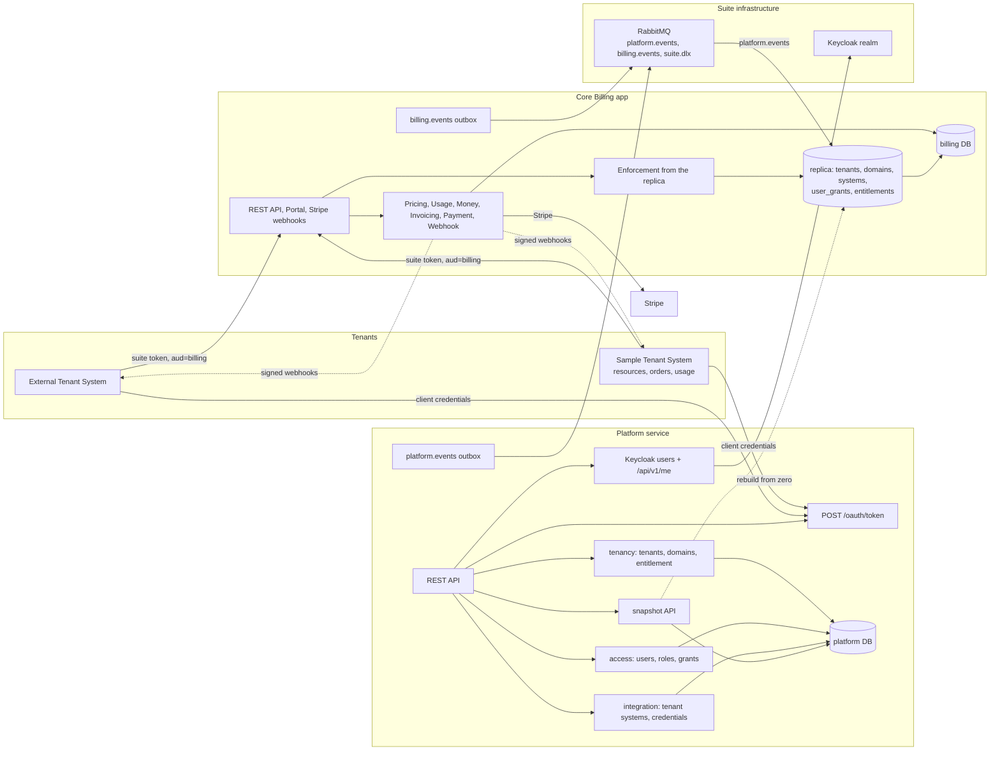

# Architecture

## System diagram

Each service has its own database and its own broker user. No service can reach another's database or publish to
another's exchange; `ops/smoke/isolation.sh` proves both. See [multi-tenancy-and-data-isolation.md](multi-tenancy-and-data-isolation.md)
and [suite-messaging.md](suite-messaging.md). The Stripe and webhook paths are unchanged from the Billing-only design:
see [payments-and-stripe.md](payments-and-stripe.md) and [webhooks-and-events.md](webhooks-and-events.md).

## Decision ledger

| Area | Decision | Why |
|---|---|---|
| Deployment shape | A Platform service plus one or more apps (Billing first) and any tenant systems, each a separate build, database and process. They meet only through signed tokens, RabbitMQ events and the snapshot API; at build time they share one technical core, `core/`, and the documents in `contracts/` | Platform owns tenancy, identity and access; an app owns its data and enforces what Platform granted; a new app joins without touching the others |
| Backend | Java with Spring Boot, DDD and Clean Architecture, built as a Gradle multi-module project; used for both Billing and the Sample Tenant System | Chosen by the project owner |
| Backend shape | Modular monolith per system, with Gradle modules as bounded-context boundaries | Wallet, Ledger and the outbox must change in one ACID transaction on one database |
| Backend layering | A bounded context is a Gradle module with `api`, `domain`, `application` and `adapter` source sets. `domain`, `application` and `adapter` group packages by feature first and then by role, in every context, including one with a single feature (`customer.application.customer.command`); no class sits in a layer-root or feature-root package. In `application` the roles are `command` (only `*UseCase` classes), `query`, `port` (interfaces and their data carriers), `service` (collaborators and settings that use cases share, and the `<Interface>Service` that implements an `api` interface for other contexts) and `exception`. In `adapter` the roles are technologies: `adapter.<feature>.<technology>` with `persistence`, `web`, `messaging` and the packages of an external system (`provider`, `keycloak`, `http`, `crypto`, `json`); a feature's write and read repositories share its `persistence` package and each feature has its own controller. `api` is the one exception: its packages are named for the capability a caller uses (`lookup`, `invoice`, `wallet`), not for a feature. Tests mirror the production packages. Both systems follow this shape; the convention lives in each build's `build-logic/` | Keeps the module boundary above the framework, gives every package one job and every kind of class one home, and lets the build enforce the shape |
| Inner layers | `domain` and `application` are plain Java: no Spring, JPA or Jackson; persistence types stay in the adapter | Business rules stay independent of the framework, and the rule can be enforced mechanically |
| Persistence | jOOQ over generated tables, in both systems. Each system has one `jooq-schema` module holding the tables and records generated from its Flyway migrations and committed to git; a drift test regenerates them in a throwaway PostgreSQL and fails when they are out of date. Every adapter injects `DSLContext`, which shares the Spring transaction and connection, so row-level security still sees the tenant setting. Plain inserts, updates and by-id reads use the DSL; locks, guarded or partial updates, append-only ledger inserts, conflict-ignoring inserts and upserts stay explicit statements. Reads select into immutable views through `Jooq*ReadRepository`. | One type-safe stack: a column renamed or retyped in a migration fails the build instead of a query at runtime, and a result set never flows into a domain type |
| Transaction boundary | An application-owned `UnitOfWork` port in `core-kernel` that use cases wrap themselves. Its Spring implementation, `SpringUnitOfWork` in `core-spring`, takes a `TransactionScopeHook` that runs first in every new transaction and rejects a nested unit of work from another scope. Billing plugs in the hook that sets `app.tenant_id` for row-level security; the sample plugs in none | Money keeps one ACID transaction while the application layer never sees `@Transactional` |
| Cross-context calls | Synchronous in-process only on the money path, through each context's public `api` package; other flows use domain events through the outbox | Money needs one transaction; the rest can stay decoupled without weakening the ledger |
| Boundary enforcement | Gradle classpath rules first, then ArchUnit and Spring Modulith in the build. Each module declares `api`, `domain`, `application` and `adapter` as Gradle source sets with different classpaths (`api` sees only the kernel and the core, `domain` adds `api`, and so on), so a framework import in the inner layers, or a domain type in the contract, fails to compile. Modulith discovers modules across Gradle modules by their shared root package and treats a sub-package as internal, so a module's `api` package is exposed to it by a `package-info.java` in the `adapter` source set, which keeps the framework annotation out of the plain-Java layers | A violation must fail the build, not depend on review discipline. The convention lives in each build's `build-logic/` (`billing/build-logic/`, `tenant/build-logic/`) |
| Pattern scope | Tactical DDD with in-process CQRS: a command side (use cases, aggregates, write ports, jOOQ persistence) and a query side (immutable views, read ports, direct SQL projections) over the same database and the same tenant-scoped transaction. No event sourcing, command/query bus, asynchronous projections or separate read store. | Reads stay immediately consistent without a second consistency model; the split keeps a read from driving a write while leaving the money path in one transaction |
| Frontend | React, Vite and TanStack (Router and Query) in one monorepo of separate apps with shared packages: Platform Admin, Tenant Admin, Customer Portal and Sample Tenant UI | Chosen by the project owner |
| Data isolation | One database per service (owner role + unprivileged app role, `revoke connect` from public). Within a service: shared schema, `tenant_id` on tenant-scoped tables, composite foreign keys and PostgreSQL Row-Level Security. Cross-service data reaches an app only as a replica it owns | A leaked query cannot reach another service's database, and the replica keeps the foreign keys and RLS that already governed the data. See [multi-tenancy-and-data-isolation.md](multi-tenancy-and-data-isolation.md) |
| Identity and authorization | One shared Keycloak realm for authentication. Platform owns users, roles, permission catalogs, assignments and app entitlement, and issues the suite's tokens. Apps enforce from a replica of that data | One authority for access, so a new app declares its codes and enforces them without its own identity model. See [authentication-and-authorization.md](authentication-and-authorization.md) |
| Tenant System authentication | Platform-issued client credentials exchanged at `POST /oauth/token` for a 10-minute suite token (`aud` = one app, `scope` = that app's granted codes). HMAC-SHA256 only for outbound webhooks | Tenant Systems self-serve outside the Platform's identity provider, and short-lived tokens limit the blast radius of a leaked secret while one authority (Platform) mints every credential |
| Stripe Connect money flow | Direct charges: the charge is created on the Tenant's connected account, so the Tenant bears fees, refunds and disputes | The specification defers this choice. Direct charges match the rules that each Tenant owns its Stripe account and its data and money stay isolated |
| Platform data | The Platform owns its own data (administrators, roles, audit entries) as a reserved tenant, so platform-level rows use the same Row-Level Security template and composite foreign keys as every Tenant | Avoids a second isolation model with nullable tenant columns; a Platform-scope request still cannot read another Tenant's rows |
| Keycloak login identifier | The username `{tenant-code}:{email}`, with duplicate emails allowed in the Realm and a `tenant_code` token claim checked against the hostname | See [authentication-and-authorization.md](authentication-and-authorization.md). Needs no Keycloak extension |
| Repository layout | One repository with `platform/`, `billing/`, `tenant/`, `core/`, `web/`, `contracts/` and `ops/` | Keeps the suite and all frontends together while they deploy separately; `contracts/` holds the documents they share (OpenAPI, event schemas, permission catalogs, the token claim list), never code, and the only code they share is the technical `core/` |
| Runtime shape | One jar with `api`, `worker` and `migrate` Spring profiles; `spring.profiles.default` activates `api` and `worker` together for dev and test, and each profile file applies only to a runtime that runs alone | The HTTP edge scales independently of background work, heavy singleton jobs get a lease instead of a second scheduler, and Flyway runs as one step rather than racing a rolling start. See [runtime-profiles.md](runtime-profiles.md) |
| Ledger and wallet model | Append-only, single-entry Ledger per wallet; the balance is a projection verified by a rebuild job; corrections are reversal entries. A wallet holds one immutable currency, so multi-currency means multiple wallets | The Ledger is the financial source of truth, and recovering from a mistake must not rewrite history; single-entry is enough because the system has no internal account transfers. Details in [wallet-ledger-and-charging.md](wallet-ledger-and-charging.md) |
| Platform service | Tenancy, users and RBAC, entitlement, Tenant Systems, credentials and token issuance move out of Billing into a `platform/` build | Two responsibilities with different lifecycles: identity and access belong to the suite, not to one app, and every app then enforces the same authorities |
| Messaging | RabbitMQ over Kafka: one topic exchange per producer (`platform.events`, `billing.events`), one durable queue per consuming app with a dead-letter exchange. Replica events carry a monotonic `version`; a consumer drops an older one | The suite needs request/reply-free state transfer and dead-letter handling, not a log or a stream-processing platform. See [suite-messaging.md](suite-messaging.md) |
| Replica and rebuild | Each app keeps a replica of the Platform data it enforces, rebuilt by paging a snapshot API and kept current by `platform.events` (`*.changed` state-transfer events) | A request costs no call to Platform, and a fresh app starts correct without replaying history. See [suite-messaging.md](suite-messaging.md) |
| Shared technical core | `core-kernel`, `core-spring`, plus `core-messaging` (outbox, inbox, broker relay, topology) and `core-replica` (snapshot client, writer, host resolver, actor resolver, entitlement filter), shared by every service build | The messaging and replica machinery is identical in every app; keeping it in one place makes a new app a wiring exercise, and ArchUnit keeps each core module free of any service's types |

### Trade-offs behind the recorded choices

- **Modular monolith instead of microservices inside Billing.** It depends most on one team and one PostgreSQL database. It fails first if a module, probably usage ingestion, needs independent scaling or its own release cadence. Module boundaries and the outbox make that extraction cheap later.
- **Direct charges instead of destination charges or separate charges and transfers.** It depends most on Tenants being the merchant of record and owning their disputes. It fails first if the Platform wants a revenue share or must carry dispute liability. Direct charges can still carry an application fee, so a switch stays inside the Payment domain.
- **One transaction for the money path instead of one transaction per bounded context.** It depends most on the money path staying inside one PostgreSQL database. It fails first when `pricing` or `usage` needs an independent release or scaling, because a synchronous cross-context call ties the callee to the caller's transaction. That is when the money path needs an explicit saga or outbox choreography.
- **A `UnitOfWork` port inside the application instead of a decorator or `@Transactional` on adapters.** It keeps the transaction boundary where the business decision is, and it costs a technical concern visible in the application layer plus the discipline to open it in every use case. That discipline is a build rule, not a review promise.
- **jOOQ instead of Spring Data JDBC or JPA.** It depends most on the schema being owned by the Flyway migrations and on a normal compile needing no database: the generated module is committed, and a Testcontainers drift test regenerates it on demand. It fails first when a migration changes a column and nobody regenerates the schema, which that test reports as a build failure, or when an adapter needs a query shape the generated tables cannot express. The cost is a generated module to review and a dependency on running PostgreSQL to regenerate it.
- **In-process CQRS on one database instead of a separate read store or asynchronous projections.** A read sees the write immediately because both use the same transaction and row-level security, and the query side owns its views and ports, so a read cannot accidentally drive a write. It depends most on the read workload fitting the same PostgreSQL database and the same tenant-scoped transaction. It stops being enough when reporting or search needs its own index, denormalised store or independent scaling; at that point a projection and a separate read store are added behind the existing read ports, and the handlers change, while the command side and the ledger do not. The cost today is two models for the same data (a generated record and a View) and the discipline to keep list, page and search SQL out of the write side, which the architecture rules enforce.
- **ArchUnit plus Spring Modulith instead of one mechanism.** It depends on keeping the two rule sets separate: ArchUnit owns layer, purity and import rules, Modulith owns module verification and event documentation. It costs a dependency and a second mechanism; overlapping rules are waste, not extra safety.
- **Billing-issued API keys instead of Keycloak client credentials for Tenant Systems.** It depends on Tenant Systems remaining third parties outside the Platform's identity provider. It fails first when many tenants demand OIDC or compliance requires short-lived credentials; then a token layer is added and credentials migrate, while the authentication filter and Tenant Context stay unchanged. The cost is a long-lived secret, contained by scopes, rotation with overlap, revocation, rate limits and audit rather than by automatic expiry.
- **One shared technical core instead of two independent builds.** It depends on both systems staying in one repository and moving together, because a change to `core/` can break either build and CI runs both. It costs the property that the sample builds with no shared code: the sample no longer proves that a system outside this repository can integrate without Billing's libraries, although the runtime contract in `contracts/` is still everything it uses to talk to Billing. It stops being the right call if the sample becomes its own repository or a published reference; then the core is published as an artifact or the few types the sample uses are copied back. Keeping the core to technical ports and implementations limits that cost, because anything domain-specific would couple the two systems' models.

### Module boundaries

Bounded contexts follow the functional areas in [overview-and-scope.md](overview-and-scope.md). Each service is its
own Gradle build with its own `build-logic/`, and `settings.gradle.kts` lists the modules that exist; the build files
own the dependency rules.

**Platform** (`platform/`) — the suite's tenancy, access and integration:

| Directory | Module | Holds |
|---|---|---|
| `contexts/` | `tenancy` | Tenants, tenant domains, app entitlement |
| | `access` | Users, roles, permission assignments and direct grants, `/api/v1/me` |
| | `integration` | Tenant Systems, API credentials and the token endpoint |
| `libs/` | `shared-kernel` | Platform's value objects |
| | `jooq-schema` | jOOQ classes generated from the migrations and committed |
| `apps/` | `app-boot` | Spring wiring, security and the token issuer, the snapshot API, the JWKS endpoint, jobs, migrations |
| `testing/` | `arch-fixtures` | Deliberately violating classes that prove each ArchUnit rule can fail |

**Core Billing** (`billing/`) — the suite's first app, grouped by role (each Gradle project path follows its
directory: `:contexts:money`, `:libs:jooq-schema`, `:apps:app-boot`):

| Directory | Module | Holds |
|---|---|---|
| `contexts/` | `customer` | Billing Customers and the Tenant System user mapping |
| | `money` | Wallet, Ledger, Reservation and Charge |
| | `pricing` | Pricing plans, metrics, rating and the charging orchestration |
| | `usage` | Usage metering |
| | `invoicing` | Invoices, subscriptions and the billing cycle |
| | `payment` | Payments, refunds, Stripe configuration and incidents |
| | `session` | Billing Sessions and the Customer Portal |
| | `webhook` | Webhook endpoints and delivery |
| `libs/` | `shared-kernel` | Billing's value objects: money, and the customer and wallet ids |
| | `jooq-schema` | jOOQ classes generated from the migrations and committed |
| `apps/` | `app-boot` | Spring wiring, security, jobs, the HTTP edge and the Flyway migrations, including the replica tables |
| `testing/` | `arch-fixtures` | Deliberately violating classes that prove each ArchUnit rule can fail |

Billing no longer has a `platform` context: tenants, users, roles, Tenant Systems and credentials live in Platform.
Billing's security is `SuiteJwtDecoders` (two issuers) and `ReplicaActorResolver` (the actor from its replica), and
its host filter resolves a tenant through `ReplicaHostResolver`. An ArchUnit rule fails the build when a Billing class
names `dev.ngb.platform`, `dev.ngb.tenant` or `dev.ngb.notification`, and a Gradle task fails when a Billing project
declares such a dependency.

**The shared core** sits beside the services, in `core/`. It is its own Gradle build that `platform/`, `billing/`
and `tenant/` include with `includeBuild("../core")`:

| Module | Holds |
|---|---|
| `core-kernel` | Plain Java ports and helpers: `UnitOfWork` and `TransactionScopeHook`, `Clock`, `IdGenerator`, `SecretCipher`, the event, inbox and publisher ports, `TenantId` and `TenantSystemId`, the security `Actor` model, `ExpectedVersion`, the DDD base types and the `Backoff`, `Causes`, `Text` and `PageSize` helpers |
| `core-spring` | The Spring implementations: `SpringUnitOfWork`, `SystemClock`, `UuidV7IdGenerator`, `AesGcmSecretCipher`, `PermissionInterceptor`, `ScopedTenantContext` |
| `core-messaging` | Outbox, inbox, broker relay, the tenant-scoped envelope codec and `SuiteTopology` |
| `core-replica` | `SnapshotClient`, `ReplicaBootstrap`, `ReplicaWriter`, `ReplicaEventHandler`, `ReplicaHostResolver`, `SuiteJwtDecoders`, `ReplicaActorResolver` and `EntitlementFilter` |

Its root package is `dev.ngb.core`, outside every service's root, so Modulith does not see it. ArchUnit holds each
core module to "the JDK, the core and (for the framework modules) the framework", and none may name a service type.
`core/build-logic` keeps its own copy of the `java-conventions` plugin the services use.

Decisions:

- The Java root packages are `dev.ngb.platform`, `dev.ngb.billing` and `dev.ngb.tenant`; each build's Modulith
  discovers its modules by that root. The Gradle group is `dev.ngb` everywhere; the core is found by its coordinates
  (`dev.ngb:core-kernel`, `dev.ngb:core-spring`, `dev.ngb:core-messaging`, `dev.ngb:core-replica`).
- `money` owns Wallet, Ledger, Reservation and Charge, so the whole money path commits in one transaction that
  includes its outbox row.
- `shared-kernel` holds only a service's business value objects and stays small; a growing kernel is split, not
  extended. It takes no module dependency. Billing's kernel exposes `core-kernel` to every layer that sees it; the
  sample's does the same.
- The core holds technical ports, their implementations and the suite's shared machinery, never a business concept
  of one service. It takes `TenantId` and `TenantSystemId` because every service is multi-tenant and the events carry
  them; `Money`, `CustomerId` and `WalletId` stay in the service that owns them.
- Inside a module the dependency direction is `adapter → application → domain`. `app-boot` only wires and never holds
  business rules. Persistence types live in the adapter; a domain type never names a jOOQ type. A read repository
  selects directly into an immutable view and never builds an aggregate. An ArchUnit rule keeps a context's adapters
  on the tables it owns.
- A module exposes a public `api` package. Another context may depend only on that package, and only the money path
  may call another context's business operations synchronously.

## Text conventions

A string is built with the tool that matches its shape. There is no blanket ban on `+`: the JDK has no string
templates, and forcing every value through `formatted()` makes a short message harder to read, not easier.

| Shape | Tool |
|---|---|
| A literal that spans more than one line: SQL, a JSON payload, a fixture | Text block |
| SQL that needs a shared column list or a trailing clause | Text block with `%s` and `formatted()`. The column-list constant itself stays one logical line joined with `+`, because a text block would put newlines inside the list |
| A message that inserts two or more values | `formatted()` on one literal, so the sentence stays in one piece |
| A message that inserts one value | `+` |
| An identifier, key or subject such as `wallet/<id>` or `event/<id>` | `+` |
| A number that needs padding or a fixed width | `String.format`, for example `String.format("INV-%06d", sequence)` |

Three traps the table does not remove:

- **`%` inside a template.** `formatted()` reads every `%` as a conversion start, so a SQL `like '%Insufficient%'`
  or a pattern such as `"%" + secret + "%"` keeps `+` or escapes each `%` as `%%`. A mistake here fails at runtime,
  not at compile time.
- **A text block ends with a newline.** Harmless in SQL and JSON; in a stored message it changes the text. A
  one-line diagnostic message therefore stays a plain literal with `formatted()`, never a text block.
- **A text block strips common indentation.** The closing delimiter takes part in that calculation, so it is aligned
  with the content; otherwise the SQL or JSON keeps leading spaces it did not mean to have.

Single-line JSON fragments inside assertions keep their `\"` escapes, because a text block would append a newline
that `contains(...)` would then have to match. Multi-line JSON payloads are text blocks with one field per line.

This convention is recorded for review only: it is not enforced by the build, unlike the layer rules above. A change
that breaks it fails no task.

## Technical principles

| Group | Requirement |
|---|---|
| Multi-tenancy | Tenant Context is determined and controlled centrally |
| Data Isolation | No cross-Tenant access |
| Identity | One email can have several independent accounts, one per Tenant |
| Authorization | Hybrid RBAC, Permissions by Platform or Tenant Scope |
| Financial Consistency | The Ledger is the audit source for financial transactions |
| Idempotency | No duplicate transaction is recorded on retry |
| Reservation | Holding and releasing budget stays consistent |
| Integration | REST API, Events and Webhooks |
| Payment | Tenant-owned Stripe Configuration, Direct and Connect |
| Credential Security | Encrypted Credentials, Secret Management support |
| Reliability | Retry, Outbox, Dead Letter and integration error handling |
| Audit | Administrative actions and transactions are traced |
| Extensibility | Payment Providers, Pricing Models and Tenant Systems can be added |
