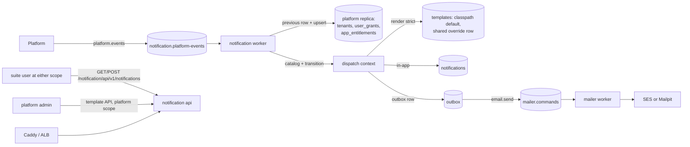

# Notification Service

## Overview

The suite has a **delivery** service (`mailer/`) but nothing that decides *when* to notify and *what* the message says.
This plan adds `notification/`, the suite's fourth deployable: it consumes `platform.events`, keeps the standard
Platform replica, turns state transitions into typed notifications, renders suite-wide templates, stores in-app
notifications and publishes **already-rendered** `email.send` commands to `mailer.commands`.

Recipients are the suite's own users: tenant users and Platform administrators. Customer, payment and invoice
notifications stay with the Tenant System that owns that relationship, so this service reads no Billing data and Billing
is not touched.

Two decisions were revised after the first implementation, both recorded in the phase files and
`docs/notification.md`:

- **Templates are suite-wide, not tenant-overridable.** One row per `(template_key, locale)` serves every tenant, and
  `notification_templates` carries no `tenant_id` and no RLS. Only a Platform user at platform scope may edit them, so a
  tenant administrator has no surface for rewriting an email.
- **Platform administrators are recipients** of the three `ACCESS_*` types, exactly like tenant users. Their rows live
  under the reserved Platform tenant, so the existing RLS, tables and dispatch path are reused; mailer stopped refusing
  the Platform tenant and now has a `mailer_tenants` row for it.

This reverses a documented non-goal (`docs/overview-and-scope.md`) and supersedes the cancelled phase 10 of
`261112-0726-enterprise-suite-foundation`. Phase 1 records the reversal before any code exists.

## Key Decisions

| Decision | Choice | Why |
|---|---|---|
| Deployable | New `notification/` build, own database, own broker user, `api` + `worker` + `migrate` runtimes | It owns templates, preferences and a stored read model; none of that belongs in mailer or Billing |
| Event source | `platform.events` only, through its own queue | Recipient data already arrives in `user-access.changed`, and the replica is rebuilt from Platform's snapshot API |
| Who is notified | Five fixed catalog types; audience is resolved from the replica | A configurable rules engine was rejected: it is a workflow engine with no second real case |
| Authority for state | The replica, never a synchronous call back to Platform | The replica is a version-guarded materialized view, and the fact being notified is the event, not the live row |
| Channels | Email (delegated to mailer) + stored in-app | Real-time SSE was cut: it is a separate subsystem with its own failure modes |
| Rendering | Logic-less, strict, HTML-escaped; default in classpath, one shared override row | Template injection and half-filled sends are the two failure modes worth designing out; shared content removes the per-tenant authoring surface |
| Email transport | Publish `email.send`; mailer accepts every tenant | The delivery ledger, retry and DEAD policy already exist and must not be duplicated |
| In-app gate | `notification` entitlement on HTTP only | The background path has no tenant context and email is a suite capability, not an app feature |

## Architecture

Two contexts, mirroring Billing's split: `platform` owns the replica tables and exposes read ports through its `api`
module; `dispatch` owns the catalog, templates, in-app rows, dispatch records and the email publisher. A second
context is not speculative — it is the only way to satisfy `context-uses-only-own-tables` once replica tables and
notification tables coexist in one service.

## Extension Trace

Two channels are real today, not hypothetical, and their capabilities differ: email is delegated and asynchronous
(mailer retries it, and `SUCCEEDED` means accepted), while in-app is a local insert with no retry and an immediate
read. They therefore share only the acceptance use case; the write paths stay separate and no uniform `Channel` port is
built. A third channel (push, SMS) has no second case and is not scaffolded: it would add one adapter, one enum value
and one column, and the acceptance use case's two branches are where it would attach.

The second producer is also not built. Today only Platform produces the events this service consumes; the command it
publishes (`email.send`) already belongs to mailer. When a Billing-origin notification is wanted, the load-bearing
decision is *not* the channel but the recipient data, which Billing does not publish — that is a new contract or a
producer-side resolution, recorded as an open boundary in Known Gaps rather than pre-solved here.

## Goals

| # | Goal | Priority |
|---|------|----------|
| 1 | A Platform state transition becomes exactly one in-app notification and one queued email per recipient | P1 |
| 2 | Every notification is answerable: which event, which type, which template version, which recipients, why one was skipped | P1 |
| 3 | Tenant content is editable without redeploying; users can mute categories and choose a language | P1 |
| 4 | Mailer stays delivery-only and Billing stays untouched | P1 |
| 5 | A new app joins the suite through a build, a permission catalog and a proxy route, with no Platform code change | P1 |
| 6 | Replaying an event, or recomputing access twice, never sends a second copy | P1 |

## Non-Goals

- Customer, payment, invoice, dunning or any Billing-origin notification.
- SMS, push, Slack, Telegram, or any real-time SSE stream.
- A tenant-configurable rules engine, a template editor UI, or bulk/marketing campaigns.
- Attachments, bounce and complaint processing, digest scheduling, or a second retry loop for email.
- Webhooks: they stay in Billing.
- Reading another service's database, or any synchronous HTTP call on the event path.
- Multi-region or per-tenant SES credentials; mailer already owns that.

## Constraints

- Recipients come from `user_grants` (already carries `email`, `display_name`, `status`, `permissions`).
- No change to the message envelope, to `contracts/commands/email.send.schema.json`, or to `mailer/`.
- Background work must not need an HTTP tenant context: iterate tenants explicitly like `TenantSweep`.
- RLS on every tenant-owned table, migrated by the owner role, read by `notification_app` (never a superuser).
- Every endpoint requires a **tenant scope**; a platform-scope caller gets `403`. The entitlement filter passes
  platform scope unconditionally, so without this rule `platform.localhost/notification/...` would be an unintended
  third door.
- Self-service endpoints require a **user** principal: `@Authenticated` also admits a Tenant System credential, so the
  guard is explicit, not the marker alone.
- The app's audience is a new Keycloak audience mapper; it is not inferred from the permission catalog.
- Platform keeps its first replica consumer and gains a second: `platform.service-clients` is already a list, so this is
  one configuration entry with its own id, SHA-256 secret hash and `platform:replica:read` — no Platform Java change.
- `contracts/permissions/notification.yaml` is the one file that registers the app code (Platform's
  `ClasspathAppCatalog` reads `classpath*:permissions/*.yaml`, packaged from that directory).

## Phases

| # | Phase | Status |
|---|-------|--------|
| 1 | [Scope, Docs and Contracts](./phase-01-scope-docs-and-contracts.md) | Pending |
| 2 | [Build Skeleton and Architecture Gates](./phase-02-build-skeleton-and-gates.md) | Pending |
| 3 | [Platform Replica, Inbox and Tenant Sweep](./phase-03-replica-inbox-and-sweep.md) | Pending |
| 4 | [Templates, Rendering and Locale](./phase-04-templates-and-renderer.md) | Pending |
| 5 | [Catalog, Transitions and In-App Store](./phase-05-catalog-and-in-app-store.md) | Pending |
| 6 | [Email Publisher, Outbox and Dispatch Ledger](./phase-06-email-publisher-and-dispatch-ledger.md) | Pending |
| 7 | [HTTP API, Security and Permissions](./phase-07-http-api-and-security.md) | Pending |
| 8 | [Ops Seams, End-to-End and Docs](./phase-08-ops-seams-and-e2e.md) | Pending |

## Repository Facts Verified Before Planning

| Fact | Evidence |
|---|---|
| `user-access.changed` carries `email`, `display_name`, `status`, `permissions`, `version` | `contracts/events/platform/user-access.changed.schema.json` |
| The replica's `user_grants` table already has an `email` column | `core/core-replica/src/main/resources/dev/ngb/core/replica/replica-tables.sql` |
| Adding `contracts/permissions/<app>.yaml` registers the app code with no Platform code change | `platform/apps/app-boot/src/main/java/dev/ngb/platform/boot/catalog/ClasspathAppCatalog.java:23`, `platform/apps/app-boot/build.gradle.kts:51-56` |
| Billing maps replica tables to a `platform` context and `EventInbox`/`Outbox` to `boot` | `billing/apps/app-boot/src/test/java/dev/ngb/billing/architecture/ArchitectureRules.java:37-70` |
| An absent credential row for a `fromKey` falls back to the suite's default identity | `mailer/.../credential/aws/ConfiguredSenderResolver.java` (`shared(...)`) |
| A per-service broker user is a `declare_user` block plus isolation assertions | `ops/rabbitmq/declare-users.sh`, `ops/smoke/isolation.sh:46-104` |
| The proxy strips a prefix and keeps the Host | `ops/caddy/Caddyfile` |
| No `mailer.yml` exists; mailer's build runs only in `suite.yml`/`deploy.yml` | `.github/workflows/` |

## Success Criteria

- [ ] `cd notification && ./gradlew build` passes, including ArchUnit, its meta test, Spring Modulith, the jOOQ drift
      test and the isolation gate, and the five existing builds stay green.
- [ ] With compose: granting a user access produces exactly one Mailpit message, one `notifications` row and one
      mailer ledger row in `SUCCEEDED`.
- [ ] Replaying the same platform event adds no email and no in-app row.
- [ ] A `DISABLED` user, or a muted type, produces no email; the reason is recorded on the dispatch row.
- [ ] `ops/smoke/isolation.sh` proves `notification` cannot reach another service's database or exchange.
- [ ] `docs/overview-and-scope.md` no longer lists a notification service as a non-goal.
- [ ] `git diff --stat mailer/` is empty, `billing/` is untouched, and `platform/` differs only by the second
      `service-clients` entry in `application.yml`.

## Cross-Plan Dependencies

| Relationship | Plan | Status |
|-------------|------|--------|
| Supersedes | `261112-0726-enterprise-suite-foundation` phase 10 (email and templates) | Cancelled; delivery split into mailer, content into this plan |
| Depends on | `261115-0307-mailer-service` | Completed |
| Consumes | `platform.events` and Platform's snapshot API | In production |
| Unblocks | A future in-app realtime stream, a second producer app | Not planned |

## Red Team Review

Four adversarial passes (assumption destruction, failure modes, scope, security) ran against the first draft and every
finding was checked against source before being applied. Findings that survived, and what changed:

| Severity | Finding | Applied |
|---|---|---|
| Critical | The relay needs `publish_status`/`publish_next_at`, which Billing added in `V22__outbox_broker_cursor.sql`, not the short table in `V2` | Phase 6 copies the final outbox shape plus both partial indexes |
| Critical | `event_inbox` with a `tenants` foreign key dead-letters every brand-new tenant's first event (Billing removed exactly that FK in `V25`) | Phase 2 specifies the inbox with no FK, its processed index and RLS |
| High | `MessagingProperties` has `exports`, not `exchanges`, and an empty map makes `relayDue()` a silent no-op | Renamed everywhere; startup asserts the route set is non-empty |
| High | `ReplicaBootstrap` needs the worker profile **and** the listener container; an unprofiled bootstrap breaks the `api` runtime | Both are `@Profile("worker")`; `PlatformEventsHandler` added to the file list |
| High | Nothing in the plan could read the pre-upsert row: `ReplicaEventHandler.handle` is a one-liner with no hook | Phase 3 owns an `InboundEventHandler` that reads, upserts, then dispatches |
| High | jOOQ read classes were placed in `application`, which has no jOOQ on its classpath and a rule forbidding it | Ports implemented as `*Service` in `service`, queries as `Jooq*` in `adapter/.../persistence` |
| High | Readiness was never wired to `replica_state`; a bean named after the class produces a key nobody includes | Contributor bean named `replicaState`, included in both profiles, asserted by a test |
| High | `@Authenticated` admits a Tenant System, so a machine could write a preference row | `TenantScopeAndUserGuard` refuses platform scope and non-user principals, with tests |
| High | A tenant name that sanitises to `""` fails `minLength: 1` and dead-letters that tenant's stream | `fromName` is omitted when empty; the contract test covers it |
| Medium | `Profile` has eleven components; a seven-argument copy does not compile | Phase 2 says to copy mailer's real profile |
| Medium | A `platform` api package needs `@NamedInterface("api")` for `modules.verify()` | Added to Phase 2 |
| Medium | The sweep would iterate the platform pseudo-tenant, whose publishes mailer refuses | `activeTenantIds()` excludes it, asserted by a test |
| Medium | The coalescing window was racy and its premise was wrong (a role edit is one email per different user) | Coalescing removed; the unique dispatch key is the only dedupe |
| Medium | No retention: in-app bodies, inbox, outbox and dispatch rows grow forever | `HousekeepingJob` with four boundaries added to Phase 6 |
| Medium | `unreadCount` was asserted by the smoke script but never designed | List response carries it; API test asserts it decrements |
| Medium | The `before` cursor mixed `created_at` and `id` with no tuple comparison | Cursor is the UUID v7 id alone |
| Low | `isolation.sh` arithmetic was wrong (8 new lines, not 12) and the docs line reference was off by four | Corrected |
| Low | Phase 4/5 were swapped between the index and the files | Renamed and reordered |

Rejected findings:

- *"Collapse to one context."* The replica tables must be owned by a context that is not `dispatch`, or the transition
  rules read another concern's tables; the split is what Billing already does and the cost is one `package-info` plus
  three small classes.
- *"Drop the dispatch ledger API and the template CRUD API."* Both are stated goals — "tenant content is editable
  without redeploying" and "every notification is answerable" — so they stay.

## Known Gaps Accepted

- **Tenant users only.** A Tenant's own customers are never emailed by the suite; that is the Tenant System's job.
- **No email coalescing.** A duplicate email for one user needs that user's permissions to change repeatedly inside a
  short window, which is rare; suppressing it correctly would need a lock or a conditional insert, and a racy window is
  worse than the noise it prevents. The unique `(tenant, source event, user, type)` key is the only dedupe.
- **No locale in Platform.** Language comes from a user preference, then the tenant default, then `en`.
- **A Keycloak realm change is manual on a running deployment.** The realm export is import-only.
- **No delivery truth from mailer.** `email.send` accepted means mailer recorded it; the dispatch row stops at
  "command published", and mailer's ledger remains the only delivery truth.
- **`billing` notifications would need new recipient data.** If they are ever wanted, the choice is a new Billing
  contract carrying recipients, or Billing resolving them itself; neither is pre-built.
