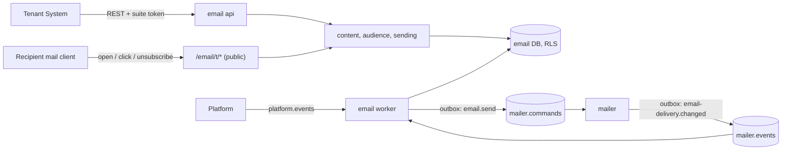

# Email App

## Overview

The suite can email its own users (`notification/` → `mailer/`), but a Tenant has nowhere to email **its own customers**.
This plan adds `email/`, a deployable that owns a Tenant's templates, receivers, groups, segments, campaigns and the
record of every email it sent, and exposes them as a REST API. Sending stays with `mailer/`, which gets one new
capability: it publishes the result of each delivery so `email/` can report `SENT` or `FAILED`.

Scope was fixed in the `/ak-advise` interview of 2026-11-15 (memory: `email-app-decisions`). Preview:
`plans/reports/advise-261115-1838-email-app-preview.html`.

This reverses two documented non-goals in `docs/overview-and-scope.md` ("notifying a Tenant's customers" and
"bulk/marketing campaigns"). Phase 1 records the reversal before any code exists.

## Outcome contract

**Goals**

1. A Tenant can send one email, a batch, or a campaign to its own customers through an API and see what happened to each.
2. Mailer stays delivery-only; its only new behaviour is publishing the outcome it already computes.
3. A second app joins the suite with Platform unchanged and the Keycloak/proxy/ops seams the notification app proved.

**Done means**

- `email/` builds, migrates and tests green; ArchUnit passes; `ops/smoke/isolation.sh` proves `email` cannot publish to
  any exchange except `mailer.commands`, and `mailer` can publish only `mailer.events`.
- An end-to-end test runs template → group → receivers → campaign → mailer reports `SUCCEEDED` → an open and a click are
  recorded → `GET /campaigns/{id}/stats` returns `sent`, `failed`, `skipped`, `opened`, `clicked`, `unsubscribed` that
  match what the test did.
- A receiver who unsubscribed, or whose address is suppressed for marketing, never receives campaign mail.
- Tenant A cannot read or write tenant B's data on any table or endpoint (RLS test per table, API test per resource).
- `contracts/events/mailer/email-delivery.changed.schema.json` exists and mailer publishes it from an outbox.
- Rendered bodies are removed after the configured retention (30 days default); metadata and events remain.
- `docs/` is correct: non-goals reversed, `docs/email.md` added, `mailer.md` and `suite-messaging.md` updated.

**Non-goals**

Console/UI, SES delivered/bounce/complaint events, A/B tests, recurring campaigns, attachments, SMS/push, custom
tracking domains, per-tenant sender-address verification, a "view in browser" public link.

**Constraints**

New deployable (not inside `notification/`); full Mustache (sections and loops) inside a strict sandbox; groups are
static plus dynamic segments; all sending through `mailer`; no personal data or bodies in logs; existing suite
patterns (jOOQ, RLS, outbox/inbox, suite tokens, `core/` shared modules); conventional commits without AI references.

## Evidence from the scout (verified in source on 2026-11-15)

| Finding | Source | Consequence |
|---|---|---|
| Mailer stores the provider message id and decides `SUCCEEDED` / `DEAD` in one place | `mailer/.../DeliverEmailsUseCase.java` `writeOutcome` | The result event is appended there, in the same transaction as `recordOutcome` |
| `core-messaging` already has the outbox appender and relay; a service opts in through `MessagingProperties.exports` | `core/core-messaging/.../MessagingProperties.java`, `notification/.../OutboxConfiguration.java` | Mailer needs a table and a bean, not new infrastructure |
| `SuiteTopology` declares `properties.exchange()` plus every queue's exchange | `SuiteTopology.declarables` | Mailer can set `exchange = mailer.events` and still declare `mailer.commands` through its queue binding |
| **`mailer_tenants` is written only by migrations** (`V6` registers the Platform tenant); `TenantSweep` delivers only for rows in it | `mailer/.../V2__delivery.sql`, `V6__platform_tenant.sql`, `TenantSweep.java` | **A command for any ordinary tenant is accepted and then sits `PENDING` forever.** Phase 2 registers the tenant when a command is accepted |
| Notification renders with JMustache, `strictSections(true)`, and refuses sections at write time | `JmustacheTemplateRenderer.java`, `docs/notification.md` | Same library, different policy; the renderer stays local to `email/` because builds share only `core/` |
| `email.send` has no header field, no bcc, no attachment; `to` ≤ 50 | `contracts/commands/email.send.schema.json` | One command per recipient; an additive optional `headers` allowlist carries `List-Unsubscribe` |
| Envelope `schemaVersion` is **2** for every producer; a wrong value rejects every message | `MessagingConfiguration` in mailer and notification | `email/` and the mailer events use `Document(2)` |
| A new app's permission catalog is `contracts/permissions/<app>.yaml`; the file name is the app code | `ClasspathAppCatalog`, notification plan phase 1 | Platform needs no code change; Keycloak needs an audience mapper |

## Key decisions

| Decision | Choice | Why |
|---|---|---|
| Deployable | `email/`, root package `dev.ngb.email`, runtimes `migrate` / `api` / `worker`, own DB `email`, own broker user | Same shape as `notification/`; the data is personal data of a Tenant's customers and must not share a database |
| Contexts | `platform` (replica), `content`, `audience`, `sending` | ArchUnit allows a context only its own tables; `sending` reads templates and receivers through the other contexts' `api` ports |
| Result path | Mailer publishes `email-delivery.changed` (`SUCCEEDED` / `DEAD`) to `mailer.events` | The suite's topic-exchange-per-producer pattern; the name follows `<aggregate>.changed` |
| Email kinds | `TRANSACTIONAL` (API) and `MARKETING` (campaign) | Unsubscribe must not block a password-reset mail; marketing must honour it |
| Suppression | `suppressions(scope = MARKETING \| ALL)`; unsubscribe writes `MARKETING`; manual block writes `ALL` | An unsubscribe is consent withdrawal for marketing only |
| Rendering | JMustache with a sandbox: sections and loops allowed; partials, lambdas, and unescaped output refused at write and load time; size, depth, iteration and output limits enforced | Tenant-authored templates with receiver-controlled data: the risk is DoS and HTML injection, not logic |
| Variables | Strict at every depth, including `receiver.*`: any unknown variable fails the render, the email is `FAILED` with the variable name and is never sent (user decision, same rule as notification) | A half-filled email must not go out. Cost: a receiver missing an attribute the template uses fails alone, the campaign continues, and the Tenant reads the reason on `GET /emails?status=FAILED&campaign=…` |
| Sending unit | One `email.send` per recipient, `requestId = emailId` | Content is personalised; mailer's ledger is keyed `(tenant, requestId, recipient)` so a retry never double-sends |
| Tracking | Self-measured: open pixel, redirected links recorded at render time, one-click unsubscribe; HMAC-signed tokens | No provider event is needed; open count means "pixel loaded" |
| Segments | A typed JSON filter AST compiled to parameterised SQL over a GIN-indexed `jsonb` attributes column | No free-form expression is ever evaluated |
| Stats | Aggregated live from `emails` and `email_events` with indexes | A counter table is a premature optimisation until a measured campaign proves it slow |
| Public endpoints | `/email/t/...` bypass the suite-token filter; tenant scope comes from the verified token | They must work from a mail client with no credentials |

## Architecture

## Extension trace

The one credible next variant is **bounce and complaint events** from SES. It must change only: mailer (a consumer for
SES notifications that publishes more `status` values on the same event) and `email/` (map the new statuses onto
`FAILED` plus an automatic `ALL` suppression). Templates, receivers, campaigns and tracking stay unchanged. The event
therefore carries an open `status` string with a documented value set and a `completedAt` guard, and `email/` ignores
unknown values. No registry, plugin or provider abstraction is built: there is one transport, `mailer`.

## Phases

| # | Phase | Size | Depends on |
|---|---|---|---|
| 1 | [Scope, docs and contracts](phase-01-scope-docs-and-contracts.md) | S | — |
| 2 | [Mailer: result events, headers, tenant registration](phase-02-mailer-result-events.md) | M | 1 |
| 3 | [Build skeleton, replica and gates](phase-03-build-skeleton-and-gates.md) | L | 1 |
| 4 | [Templates and the sandboxed renderer](phase-04-templates-and-renderer.md) | L | 3 |
| 5 | [Receivers, groups, suppression, unsubscribe](phase-05-receivers-groups-suppression.md) | M | 3 |
| 6 | [Single and batch email, results, view email](phase-06-emails-batch-and-results.md) | L | 2, 4, 5 |
| 7 | [Campaigns](phase-07-campaigns.md) | M | 6 |
| 8 | [Tracking, public endpoints and stats](phase-08-tracking-and-stats.md) | M | 7 |
| 9 | [Dynamic segments and housekeeping](phase-09-segments-and-housekeeping.md) | M | 7 |
| 10 | [Ops seams, end-to-end and docs](phase-10-ops-e2e-and-docs.md) | M | 8, 9 |

Phases 2 and 3 can run in parallel after phase 1 (disjoint trees: `mailer/` + `contracts/` versus `email/`). Phases 4 and
5 can run in parallel after phase 3.

## Risk register

| Risk | Likelihood | Impact | Mitigation | Phase |
|---|---|---|---|---|
| Template DoS (nested loops, huge output) | High | A worker stalls for every tenant | Section depth, total iteration count, output cap and wall-clock limit; adversarial test suite | 4 |
| Receiver data injects markup into HTML | High | Phishing content sent under a Tenant's name | Escape by default; refuse `{{{ }}}` and `{{& }}`; unescaped only in the text part | 4 |
| Open redirect through the click endpoint | Medium | Suite domain used for phishing links | Redirect only to URLs recorded at render time, looked up by signed link id | 8 |
| Public endpoints become a tenant-enumeration or write-amplification surface | Medium | Data leak, load | Signed tokens, constant response for invalid tokens, per-IP rate limit, insert-only event writes | 8 |
| Segment filter scans the receiver table | Medium | Slow queries for a tenant | Closed operator set, depth cap, GIN index, `explain` check in a test, result cap per campaign | 9 |
| Mailer floods under a large campaign | Medium | Mailer ledger and SES quota exhausted | Per-tenant per-tick publish cap in the worker | 7 |
| Mailer never delivers for a new tenant | **Certain until fixed** | Every email stays `PENDING` | Register the tenant when a command is accepted | 2 |
| `email.send` change breaks notification | Low | Notification mail fails | `headers` is optional; notification's contract test must stay green | 2 |
| Personal data retained longer than stated | Medium | Compliance | Body purge job with a test; no body, address or token in logs | 9 |
| Apple Mail Privacy Protection inflates opens | Certain | Misleading stats | Documented as "pixel loaded"; first-open and total-open counted separately | 8 |

## Decisions taken during planning (2026-11-15)

| Question | Answer |
|---|---|
| How does mailer learn which tenants to deliver for? | Register the tenant when a command is accepted (`insert … on conflict do nothing`, same transaction). The tenant id stays publisher-asserted, the trust boundary `contracts/commands/README.md` already documents |
| Unknown template variable | Strict at every depth (see Key decisions) |
| Does an unsubscribe block transactional mail? | No. It writes a `MARKETING` suppression only; the Tenant adds an `ALL` suppression to block everything |
| Result event name | `email-delivery.changed`, following the `<aggregate>.changed` convention (the advice wrote `email.delivery.changed`) |

## Open questions

None blocking. Confirm while building: whether the Platform service client for `email` needs a new scope in
`platform/`'s client registry (notification needed one), and the retention period for `campaign_recipients` (phase 9).
