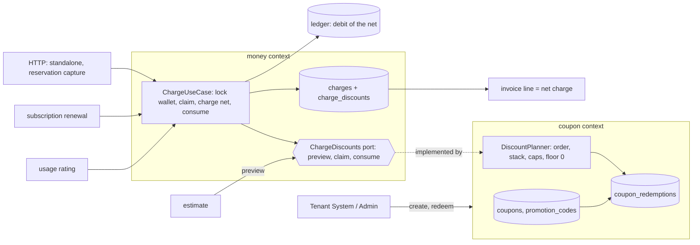

# Coupons in Billing

## Overview

Billing has no way for a Tenant to give a customer a price reduction or free credit. This plan adds a `coupon`
bounded context and one narrow seam in `money`, so that a discount is applied exactly once, in the one place every
charge passes through, without touching how prices are rounded, how the ledger is written, or what an invoice means.

Scope was fixed in the `/ak-advise` interview of 2026-11-16 (memory: `coupon-decisions`). The advice report was
delivered in the conversation only; this plan carries every confirmed decision and the verified evidence below.

## Outcome contract

**Goals**

1. A Tenant runs promotions without code changes: Administrators **and** Tenant Systems create coupons and promotion
   codes, and redeem them onto a customer's wallet.
2. Three benefits behind one strategy: percent off, fixed amount off (wallet currency), and wallet credit granted once
   at redeem. A free period is 100% off for N applications.
3. Each redemption has a duration made of any mix of: a time window from redeem, a maximum number of applications, a
   maximum total discount. No limit declared means forever.
4. Scope filters by charge source, plan and metric. Default is every charge of the wallet.
5. Several coupons may run on one wallet, applied in a fixed order, each with a stackable flag.
6. Every discount is explainable from the Charge: gross amount, each coupon's amount, and the net the wallet paid.
7. The single rounding, the minimum and maximum charge, the append-only ledger, idempotency, tenant isolation and
   lock-order rules all keep holding.

**Done means**

- Administrators and Tenant Systems create, list, read and deactivate coupons and promotion codes through the API;
  redeem a code onto a wallet (Tenant System: mapped customers only); an Administrator can attach a coupon to a wallet
  directly and revoke a redemption.
- A wallet with `SAVE20` (20% off) then `WELCOME10K` (10,000 off) is charged **70,000** for a gross 100,000 on all
  four charge paths: usage, subscription renewal, reservation capture, standalone. The Charge records gross 100,000,
  discount 20,000 and discount 10,000, and the ledger debit is 70,000.
- A fully discounted charge is recorded as a succeeded Charge of 0 with no ledger entry and no wallet movement, and
  produces no invoice line.
- A wallet-credit coupon raises the balance exactly once; the ledger entry carries a reference traceable to the
  redemption.
- Redeeming twice with the same `Idempotency-Key` redeems once. 20 parallel redeems of a coupon with 1 redemption left
  succeed exactly once. 20 parallel charges against a coupon with a total-discount budget never exceed the budget.
- A charge the wallet cannot pay consumes no application and no budget.
- Estimate returns gross and discounted amounts. A reservation made from an estimate holds the gross amount.
- `contracts/permissions/billing.yaml`, the event schemas, the generated `contracts/openapi/*.yaml` and `docs/` match
  the code; `./gradlew build` in `billing/` is green, including ArchUnit, Modulith verification and the contract tests.
- No UPDATE or DELETE path exists on `ledger_entries`. `git diff` shows no change under `platform/`, `tenant/`,
  `mailroom/`, `survey/`, `attribution/`, `notification/` or `mailer/`; `core/` changes only add the two new event types.

**Non-goals**

Eligibility and segmentation rules (new customers only, cohorts, A/B); any UI, including portal coupon entry; tax;
restoring usage when a Charge is reversed; campaign analytics; Stripe-side coupons or Stripe Checkout discounts;
cross-currency coupons; discount lines as first-class invoice lines (the invoice shows the net charge); editing a
coupon's terms after creation; auto-generated bulk code batches beyond one code per request.

**Constraints**

Round once, apply min/max, then discounts, floor 0. Money receives only the final net. Ledger append-only. Idempotent
everywhere. Tenant always from the host. Lock order is wallet, then coupon rows, then redemption rows. Layer and package
rules are enforced by ArchUnit. Generated jOOQ code is committed. Back up any database before applying a schema change
outside Testcontainers. Conventional commits without AI references. No plan, phase or finding labels in code comments,
migration names or test names.

## Evidence from the scout (verified in source on 2026-11-16)

| Fact | Where |
|---|---|
| Every charge is recorded by one use case: wallet row locked first, idempotency read after the lock, then charge, ledger entry, wallet projection, reservation and outbox event in one transaction. | `billing/contexts/money/src/application/java/dev/ngb/billing/money/application/charge/command/ChargeUseCase.java` |
| Only two other contexts call `ChargeWallet`: usage rating and subscription renewal. Standalone and reservation capture arrive over HTTP at the same use case. | `ChargeFromUsageUseCase`, `RenewSubscriptionUseCase`, `ChargeController` |
| `ChargeCommand` has no plan, metric or "this is a renewal" field. A renewal is a standalone charge whose `reference` is parsed by invoicing. | `.../money/api/charge/ChargeCommand.java`, `ChargeSource.java`, `ChargeLineFactory.java` |
| A Charge, an invoice line, a reservation capture and a ledger entry must all be positive today; `charges.amount` has `check (amount > 0)`. | `Charge.java`, `InvoiceItem.java`, `Reservation.capture`, `V6__money.sql` |
| The replay fingerprint is `(wallet, reservation, amount, usageRef, reference)`; a retry returns the recorded charge. | `ChargeUseCase.charge` |
| Reservation capture charges the actual cost and may not exceed the hold. | `Reservation.capture` |
| Estimate is a pure calculation with no wallet; reserve-from-estimate holds exactly the estimated amount. | `EstimateCostUseCase`, `ReserveFromEstimateUseCase` |
| A rating's breakdown is `PriceLine(description, metric, quantity, exact amount)` per component. | `pricing/domain/rule/PriceLine.java`, `Quote.java` |
| Postpaid collection turns each succeeded charge into an unbilled invoice line. | `CollectChargeUseCase` |
| Ledger entry types are CREDIT, DEBIT, REVERSAL; a credit needs a reference and an idempotency key. | `EntryType.java`, `CreditCommand.java`, `V6__money.sql` |
| Lock order is documented and a new flow must fit it. | `docs/concurrency-and-locking.md` |
| Table ownership is enforced per context by ArchUnit; tests mirror production packages. | `billing/apps/app-boot/src/test/java/dev/ngb/billing/architecture/ArchitectureRules.java` |
| `contracts/openapi/billing*.yaml` are generated from the controllers and compared by a test; the permission catalog and event schemas are hand-written and compared by tests. | `OpenApiContractTest`, `PermissionCatalogTest` |
| jOOQ code is generated from the Flyway migrations and committed; latest migration is `V26`. | `JooqSchemaTest`, `db/migration` |
| Event types live in `core-kernel` `SuiteEventTypes` and need a schema file under `contracts/events/billing`. | `core/core-kernel/.../SuiteEventTypes.java` |

## Design

**The seam.** `money` owns a small port, `ChargeDiscounts`, in its `api` source set; `coupon` implements it. `money`
depends on nothing in `coupon`, so there is no cycle. The port has three operations:

- `preview(request)` is read-only, takes no locks, and serves estimates.
- `claim(request)` runs inside the charge transaction after the wallet lock, locks the coupon rows with a budget and the
  wallet's redemption rows in ascending id order, and returns a quote that is guaranteed consumable.
- `consume(chargeId, quote)` runs only when the charge succeeded, and updates counters, budget and redemption state.

**Order inside `ChargeUseCase`.** lock wallet, read idempotency key, `claim`, charge the net (or take the zero-net path),
`charges.add` with its discount lines, `consume`, publish the event. A failed charge calls neither `consume` nor records
discount lines, so it consumes nothing.

**Discount rules (the pure engine, phase 2).**

| Rule | Decision |
|---|---|
| Base | The charge after the single rounding and the min/max charge (gross). |
| Eligibility | Redemption ACTIVE, `now < endsAt`, applications left, total-discount cap left, scope matches, gross at least the coupon's minimum charge, coupon not revoked. |
| Order | Percent first, then fixed amount; inside a kind, older redemption first, then id. Each discount is computed on the running net. |
| Percent | Stored as basis points (1 to 10,000). Discount = base × bps ÷ 10,000, rounded `HALF_UP` to minor units, once per coupon. |
| Caps | A discount is the smallest of: the computed value, the coupon's per-application maximum, the redemption's remaining total-discount cap, the coupon's remaining budget, and the running net. Never below 0. |
| Stacking | A non-stackable coupon runs alone. Candidates are the stackable set together and each non-stackable coupon alone; the candidate with the lowest net wins, ties go to the earliest redemption. |
| Exhaustion | A redemption becomes ENDED when it reaches its application cap, its total-discount cap or its end time. |
| Scope | Source, plan and metric filters; an empty filter means any. Plan and metric filters apply only to charges whose caller supplies them (usage, renewal). |

Worked example: 100,000 → `SAVE20` (−20,000) → 80,000 → `WELCOME10K` (−10,000) → 70,000. Reversed order would give 72,000.

**Data (summary; exact columns in phases 3 and 5).** `coupons` (immutable terms), `promotion_codes`,
`coupon_redemptions` in `coupon`; `charges` gains `discount_total` (gross is `amount + discount_total`) and allows `amount = 0` when a discount was applied;
`charge_discounts` is owned by `money`; `subscription_events` gains a nullable `paid_amount`.

**API (summary; generated contract in phases 4 to 6).** Coupons and codes under `/api/v1/coupons`; redemptions under
`/api/v1/wallets/{walletId}/coupon-redemptions` and `/api/v1/coupon-redemptions/{id}`; estimate gets an optional
`walletId`; charge responses gain `grossAmount` and `discounts`. Webhooks: `coupon.redeemed` and
`coupon.redemption-ended`. Permissions: `billing:coupon:read`,
`billing:coupon:manage`, `billing:coupon:redeem`, all grantable to a Tenant System.

**Lock order.** Redeem: wallet, then coupon row, then promotion code row, then the new redemption. Charge: wallet, then
coupon rows that carry a budget, then redemption rows. Renewal is unchanged: subscription, then wallet. No flow locks a
wallet after a coupon row.

## Decisions made while planning

| # | Decision | Why |
|---|---|---|
| D1 | The port lives in `money.api`, implemented by `coupon`. | Money must not depend on coupon; a seam only because two contexts need to agree. |
| D2 | `Charge.amount` stays "what the wallet paid" (net). Gross and discount lines are stored beside it. | Ledger, invoices, replay and events keep their meaning. |
| D3 | A fully discounted charge is a succeeded Charge of 0 with no ledger entry. A zero capture closes the reservation and returns the whole hold. Invoicing ignores zero-net charges; invoicing one on request is refused with 409. | Consumption needs a record to be idempotent; invoice lines and ledger entries must stay positive. |
| D4 | Coupon terms are immutable. Deactivation stops new redemptions; an optional `revokeRedemptions` also ends the running ones. | Charges stay explainable; a kill switch exists for a bad coupon. |
| D5 | A coupon-wide budget applies partially when less than the discount remains. | Deterministic and never over-spends. |
| D6 | Redeem by code needs `redeem`. Attaching by coupon id and revoking need `manage`. One ACTIVE redemption per coupon per wallet. The per-customer limit counts non-revoked redemptions across the customer's wallets. | Bypassing a code's limits is a management act. |
| D7 | Unknown, inactive, expired and exhausted codes all answer 404 with one message. | A caller cannot probe which codes exist. |
| D8 | A credit coupon is redeemed inside one transaction: wallet lock, conditional counters, redemption created ENDED, `CreditWallet` with key `coupon-redemption:<id>`. | Same path as any other credit; no new ledger type. |
| D9 | `charge.succeeded` and `charge.failed` gain optional `grossAmount` and `discounts`; `subscription.renewed` gains `paidAmount`; new events `coupon.redeemed` (with the redemption's limits and `endsAt`) and `coupon.redemption-ended` (`EXHAUSTED`, `REVOKED` or `COUPON_DEACTIVATED`). All are additive and, like every Billing event, subscribable as webhooks because the webhook catalog is the schema folder. | Consumers that ignore new fields keep working; a Tenant learns the whole life of a redemption without polling. |
| D10 | A coupon granted from another system (a loyalty voucher, a CRM campaign) is the Tenant System's integration, with no Billing change. Two routes are both supported: attach by `couponId` (needs `manage`, no code limits) or redeem a code kept for that purpose (needs only `redeem`; give the code no per-customer limit when one customer may receive the reward more than once). The Tenant grants in Billing first with an idempotency key from the other system's id and marks the voucher used last. | Suite apps never link to each other; both endpoints are already idempotent, so the Tenant can retry and compensate. |

## Open questions

All four were answered at validation on 2026-11-16 and recorded in the validation log below. None remain open.

## Phases

| # | Phase | Size | Status |
|---|-------|------|--------|
| 1 | [Docs and decisions](./phase-01-docs-and-decisions.md) | S | Done |
| 2 | [Coupon module and discount engine](./phase-02-coupon-module-and-discount-engine.md) | L | Done |
| 3 | [Persistence and boot wiring](./phase-03-persistence-and-boot-wiring.md) | M | Done |
| 4 | [Coupon management and redeem API](./phase-04-coupon-management-and-redeem-api.md) | L | Done |
| 5 | [Charge seam in money](./phase-05-charge-seam-in-money.md) | L | Done |
| 6 | [Callers, scope and estimate](./phase-06-callers-scope-and-estimate.md) | M | Done |
| 7 | [Metric scope](./phase-07-metric-scope.md) | M | Done |
| 8 | [Events, concurrency, end-to-end and docs check](./phase-08-events-concurrency-e2e-and-docs-check.md) | L | Done |

Phases run in order. Phases 1 and 2 are independent; phase 3 needs 2; phase 4 needs 2 and 3; phase 5 needs 3 and 4;
phase 6 needs 4 and 5; phase 7 needs 6; phase 8 needs all. They are not parallelised: phases 5 and 6 edit the shared charge path.

## Risk register

| Risk | Impact | Mitigation |
|---|---|---|
| A discount is applied in more than one place and the paths drift. | Wrong amounts, hard to detect. | One `claim` in `ChargeUseCase`; a test per charge path asserting the same 70,000. |
| `claim` and `consume` disagree under concurrency (budget changed between them). | Over-spend or an inconsistent Charge. | `claim` takes the locks and `consume` runs in the same transaction; a budget race test. |
| Zero-net charge breaks code that assumes positive amounts. | Exceptions in invoicing, reservations, events. | D3, with tests on each of the four places that assume positive. |
| A coupon-wide budget makes one row hot across wallets. | Charge latency for budgeted coupons. | Only budgeted coupons lock the row; documented; load check in phase 8. |
| Metric scope needs per-metric amounts that money does not know. | Most complex piece. | Last phase, separable: phases 1 to 6 ship without it. |
| Tenant Systems can create coupons (money given away). | Tenant-side abuse. | Every coupon needs a total bound (expiry, total redemptions or budget); `manage` is separate from `redeem`; the creating actor is stored and audited. |
| Code guessing by a Tenant System. | Free discounts. | D7 and the existing authentication-step rate limit. |
| A new context touches many registrations (settings, boot config, table owners, permissions, event types). | Build breaks late. | Phases 2 and 3 do the registrations before any behaviour. |

## Red-team review (inline, before the user's validation)

Four lenses were applied by the planner against the files cited in the evidence table. No subagents were spawned.

| Lens | Finding | Disposition |
|---|---|---|
| Assumption | The advice assumed invoice lines come from `Charge.amount`; `InvoiceItem` and `ChargeLineFactory` confirm it, but they also require a positive amount, so a 100% discount would throw. | Accepted: D3, phase 5. |
| Assumption | The advice assumed renewal is distinguishable in money; it is not (`ChargeSource` has no renewal). | Accepted: a `ChargeContext` carries the kind and plan, phase 6. |
| Failure | Discount computed before the wallet check could be consumed even when the charge fails. | Accepted: `claim` then `consume` only on success, phase 5. |
| Failure | A replayed charge after a coupon expired must still return the original result. | Accepted: replay reads the stored charge before `claim`, as today. |
| Failure | `Reservation.capture` rejects zero and amounts above the hold. | Accepted: zero capture path, and a gross hold (validated), phases 5 and 6. |
| Scope | Metric scope drags pricing into the discount base. | Kept in scope as its own last phase, so it can be reviewed or reordered alone. |
| Security | Tenant-created coupons can print money and codes can be guessed. | Accepted: mandatory total bound, D7, audit of the creating actor. |
| Security | Cross-tenant reads of coupons or redemptions. | Accepted: row-level security on every new table and an isolation test in phase 8. |

## Validation log

### Session 1 — 2026-11-16

| # | Question | Answer | Propagated to |
|---|---|---|---|
| 1 | Reservation from an estimate holds the gross or the discounted amount? | Gross (recommended) | Phase 6 behaviour 4, `docs/coupons.md` in phase 1 |
| 2 | A fully discounted charge? | Record a succeeded Charge of 0, no ledger entry (recommended) | Design D3, phase 5 |
| 3 | Plan and metric scoped coupons on reservation capture and standalone charges? | They never apply there; no new request fields (recommended) | Phase 6 behaviour 5, phase 7 rule 6, `docs/coupons.md` |
| 4 | Deactivating a coupon? | Running redemptions keep working; `revokeRedemptions` ends them (recommended) | Design D4, phase 4 |

All four answers matched the plan's defaults, so no phase needed a content change.

### Verification results

- Tier: Full (8 phases). Claims checked: 41 (file paths and symbols by `find` and reads of the owning source).
- Verified: 41. Failed: 0.
- Unverified (to resolve during the phase that needs it, not blocking): whether `CreditWalletUseCase` can be called from
  inside the redeem transaction and re-lock a wallet the caller already locked (phase 4, step 2: read `UnitOfWork` nesting
  before relying on it); whether `ops/smoke` has a billing flow to extend (phase 8, step 1 of the files list says "if");
  the exact Gradle `--tests` name patterns (phase verification commands use the class names seen in the repository).

### Whole-plan consistency sweep

Searched all plan files for `gross_amount`, the old phase file names, "open question" and "Phase 3 does all registrations".
Fixed: the data summary now says `discount_total` (gross is `amount + discount_total`), phase links and sizes match the
files, the dependency sentence matches each phase's `dependencies`, and the open-questions section is closed. No
contradictions remain.
