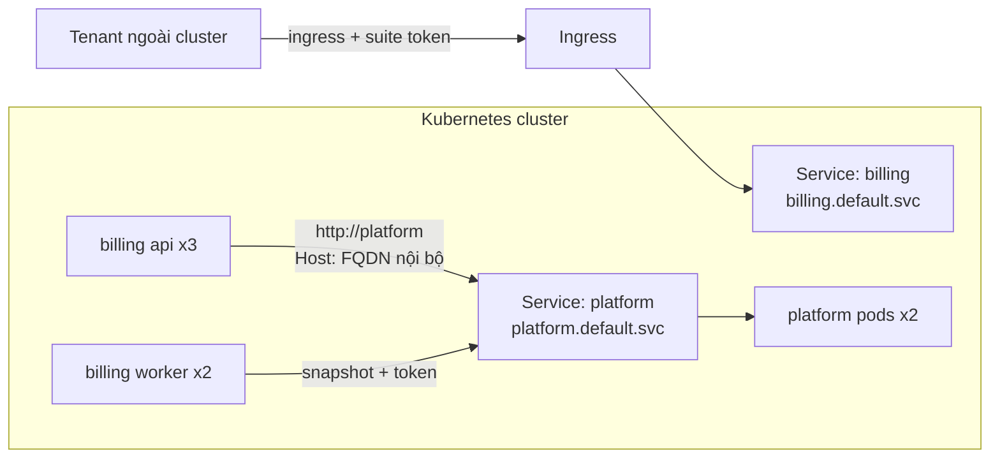

# Core Billing — service discovery và load balancing giữa các service

Date: 2026-11-14 · Scope: có nên thêm Spring Cloud LoadBalancer và Spring Cloud Netflix Eureka cho giao tiếp
service-to-service, trên môi trường đích Kubernetes · Status: advisory, no code written.

## Confirmed reframing

**Problem.** Các service cần gọi nhau bằng một địa chỉ ổn định khi chạy nhiều instance với IP thay đổi. Hiện mọi cạnh
gọi nội bộ đều dùng `baseUrl` tuyệt đối trong config — `BILLING_PLATFORM_BASE_URL` trong `application.yml:151` và
`tenant.billing.base-url` trong `tenant/apps/app-boot/src/main/resources/application.yml:40` — và `TokenSettings.forBaseUrl()`
suy ra `<baseUrl>/oauth/token` từ chính giá trị đó. Mỗi service mới, hoặc mỗi lần địa chỉ đổi, đều buộc phải sửa config
và redeploy mọi caller.

Nhưng khảo sát cho thấy blocker thật không phải discovery. Cả Platform lẫn Billing đều chọn tenant từ Host header:
`SuiteTenantFilter.java:33` gọi `hosts.resolve(request.getServerName())`, và Platform `TenantContextFilter.java:38-40`
làm điều tương tự. Chỉ `/actuator/health` được bypass. Nghĩa là `/oauth/token` và `/internal/replica/{stream}` đều
phải có Host resolve được thành một domain đã đăng ký. Một client trỏ tới `http://platform` sẽ gửi `Host: platform`,
`resolveHost` không tìm thấy domain nào, và trả 404. Discovery chọn *instance* thì tốt, nhưng nó cũng đổi *Host
header* — mà đó chính là thứ hệ thống dùng để chọn tenant.

Ở local, hai lớp che giấu lỗi này: `docker-compose.yml:151` đặt network alias `platform.localhost` để Host khớp
domain đã đăng ký, và `SAMPLE_TENANT_EXECUTION_ENABLED=false` tắt nhánh tenant gọi Billing. Trên Kubernetes cả hai
lớp che đều biến mất.

**Project owner's decisions**

| Topic | Choice |
|---|---|
| Lý do | Nhiều instance, IP động |
| Môi trường đích | Kubernetes |
| Eureka có bắt buộc | Không — mục tiêu là "service tự tìm thấy nhau", Eureka chỉ là phương tiện |
| Cạnh nội bộ cần discovery | Sẽ có thêm service mới (hiện chỉ Billing → Platform) |
| Tenant | Hệ thống **bên ngoài** cluster, dùng credential tạo trước qua Platform, đi qua ingress |

**Exact requirements**

1. Billing (api và worker) gọi Platform bằng một tên ổn định, không có IP trong manifest.
2. Service mới thêm vào không phải sửa config của mọi caller hiện có.
3. Nhiều replica được cân bằng tải.
4. Call nội bộ vẫn mang Host resolve được thành tenant scope `PLATFORM`.
5. `TokenSettings.forBaseUrl()` vẫn suy ra được token URL từ cùng cách resolve đó.
6. `core-feign` vẫn dựng client bằng `Feign.builder().target(api, baseUrl)` — không bị ép sang `@FeignClient`.
7. `docker compose` ở local tiếp tục chạy y như hiện tại.

**Goals.** Đạt được yêu cầu 1-3 mà không thay đổi bất biến bảo mật "tenant luôn lấy từ host đã resolve"
(`SuiteActorResolver` kiểm tra token `tenant_id` phải bằng tenant của host, khác thì ném `TenantMismatchException`),
và không thêm hạ tầng stateful nào phải vận hành.

**Done means**

- Manifest không còn `BILLING_PLATFORM_BASE_URL` dạng IP; base URL là tên service.
- Scale Billing api lên 3 replica: request tới Platform phân tán qua nhiều pod.
- Snapshot fetch và token fetch thành công bằng Kubernetes Service DNS thuần.
- `ops/smoke/suite-smoke.sh` và `ops/smoke/isolation.sh` vẫn xanh.
- `FeignBoundaryTest` và `core-feign-is-self-contained` vẫn pass.
- `docker compose up` local chạy với cấu hình như cũ.

**Non-goals.** Dựng Eureka server. Đổi ingress công khai. Tenant ngoài cluster (đã dùng token tạo trước qua ingress).

**Constraints.** ArchUnit rules giữ nguyên; `core-feign` không được biết service nào; Host→tenant cho traffic ngoài
không đổi.

## Preview of the target state



Before → after (cấu hình):

| | Hiện tại | Sau |
|---|---|---|
| Platform URL | `BILLING_PLATFORM_BASE_URL=http://platform.localhost:8080` | `http://platform.default.svc.cluster.local` |
| Token URL | suy ra `<baseUrl>/oauth/token` | cùng, từ DNS nội bộ |
| Host khi gọi nội bộ | `platform.localhost` (nhờ compose alias) | FQDN nội bộ — **phải đăng ký thành domain `PLATFORM`** |
| Thêm service mới | sửa config mọi caller | không sửa; thêm `Service` + gọi theo tên |

Điểm cần để ý ở cột cuối: discovery giải quyết *địa chỉ*, nhưng không giải quyết Host header. Nếu không đăng ký
domain nội bộ, đổi sang tên service sẽ làm Platform trả 404 ngay — đúng lỗi mà compose đang che bằng alias.

## Verdict

Thêm Eureka **không giải quyết vấn đề thật** của dự án này, và trên Kubernetes nó còn là sai công cụ. Nhưng yêu cầu
đã chạm đúng một khiếm khuyết có thật: cả Platform lẫn Billing chọn tenant từ Host header, và Platform chỉ bỏ qua bước
này cho `/actuator/health`. Với `http://platform`, cả token fetch lẫn snapshot fetch đều vỡ — trước khi discovery kịp
phát huy tác dụng.

Kubernetes đã giải sẵn bài toán "nhiều instance, IP động": một `Service` cho DNS ổn định, kube-proxy cân bằng tải qua
các pod. Thêm Eureka là thêm một registry stateful phải vận hành, health-check và lo split-brain, để thay một thứ đã
có sẵn.

## What you should do

1. **Đăng ký hostname nội bộ thành domain `PLATFORM`.** Pattern đã có: `PlatformBootstrap` đang idempotent tạo domain
   cho `platform.tenancy.platform-hostname`. Cần mở rộng để nhận nhiều hostname; chi tiết ở plan
   `261114-0930-service-discovery-internal-hostnames`.
2. **Đặt base URL bằng FQDN đó**, không phải IP: `BILLING_PLATFORM_BASE_URL=http://platform.default.svc.cluster.local`.
   Khi đó Host header *chính là* domain đã đăng ký ở bước 1, `resolveHost` tìm thấy, `TokenSettings.forBaseUrl()` suy
   ra `<fqdn>/oauth/token` đúng, và Service tự cân bằng tải qua các pod.
3. **Giữ nguyên issuer.** `PLATFORM_TOKEN_ISSUER` và `BILLING_PLATFORM_ISSUER` phải là chuỗi công khai ổn định, không
   đổi sang DNS nội bộ. Chỉ `BILLING_PLATFORM_BASE_URL` và `BILLING_PLATFORM_JWK_SET_URI` đổi. Nhầm lẫn hai thứ này
   đúng là bẫy đã ghi trong journal `2026-11-14-fix-issuer-fallback-traps`.
4. **Chỉ thêm Spring Cloud Kubernetes LoadBalancer nếu thật cần client-side LB**
   (`spring-cloud-starter-kubernetes-client-loadbalancer`, BOM `2025.1.4` đã quản lý ở `5.0.4`). Nó cho phép chọn pod
   IP phía client và retry-aware routing — thứ kube-proxy không làm.
5. **Nếu vẫn dùng Spring Cloud LoadBalancer, phải sửa `FeignClients` trước.** Hiện nó dựng
   `Feign.builder().target(api, baseUrl)` với URL tuyệt đối, mà LB chỉ cắm vào Feign qua đường `@FeignClient` hoặc
   `FeignBlockingLoadBalancerClient`. Thêm dependency mà không sửa chỗ này thì không có tác dụng gì.

## What you shouldn't do

- **Đừng dựng Eureka server trên Kubernetes.** Bạn đã có registry: Kubernetes API + `Service` DNS. Eureka là một
  server stateful phải vận hành, health-check và chịu split-brain — để thay một thứ kube-proxy làm sẵn.
- **Đừng thêm `spring-cloud-starter-loadbalancer` rồi kỳ vọng nó hoạt động.** Trong `spring-cloud-starter-openfeign:5.0.4`
  nó là `<optional>true</optional>` (đã kiểm tra POM), và việc resolve `:core-feign:runtimeClasspath` cho kết quả 0 lần
  xuất hiện `loadbalancer`. Đường `Feign.builder().target(url)` bỏ qua LB hoàn toàn, im lặng.
- **Đừng tin header nội bộ (`X-Suite-Tenant`).** `SuiteActorResolver` ghi rõ tenant luôn từ host, và token
  tenant-system có `tenant_id` khác host sẽ ném `TenantMismatchException`. Mở đường đó là tự tạo lỗ hổng chọn tenant.
- **Đừng làm discovery trước khi sửa Host resolution.** Bạn sẽ đổi DNS thành công rồi vẫn nhận 404.
- **Đừng bật LB retry cùng `LinearRetryer`.** `RetryableFeignBlockingLoadBalancerClient` cộng với retryer hiện có sẽ
  nhân số lần thử (3×3 = 9), phá vỡ `maxAttempts` mà `BillingErrorDecoder` và `StatusFeignErrorMapper` đang giả định.
- **Đừng thêm abstraction đa-discovery** (Eureka + K8s + Consul) khi mới có một cạnh nội bộ thật: Billing → Platform.

## What could be better / more efficient

Xếp theo effort-to-impact:

| # | Việc | Effort | Tác động |
|---|---|---|---|
| 1 | Đăng ký FQDN nội bộ làm domain `PLATFORM` | Rất thấp | Mở khoá toàn bộ, không đụng code core |
| 2 | Đổi base URL sang DNS name | Rất thấp | Đạt yêu cầu 1, 2, 3 |
| 3 | Spring Cloud Kubernetes LB | Trung bình | Chỉ khi cần client-side LB thật |
| 4 | Rewrite `FeignClients` cho LB | Cao | Chỉ khi đã chọn #3 |

Điểm quan trọng: #1 + #2 đã đạt đúng Done means. Eureka không nằm trong đường đó.

## My take and how to get there

Chọn **Kubernetes-native, không Eureka**. Mục tiêu đã chốt là "nhiều instance, IP động" cộng "sẽ có thêm service".
Trên Kubernetes, thêm service = tạo một `Service` object; caller dùng DNS name; không caller nào phải sửa khi pod đổi
IP. Đó chính xác là yêu cầu 2, đạt được với zero dependency mới.

Đường đi từ hiện trạng → đích:

1. Thêm biến cấu hình cho hostname nội bộ của Platform; `PlatformBootstrap` đăng ký nó thành domain `PLATFORM`
   (idempotent, như nó đang làm cho `platform-hostname`).
2. Trong manifest đặt `BILLING_PLATFORM_BASE_URL` = FQDN nội bộ; xoá mọi IP/port cứng.
3. Viết `Service` cho mỗi app.
4. Chạy `ops/smoke/suite-smoke.sh` và `ops/smoke/isolation.sh` để chứng minh không hồi quy.
5. *Chỉ khi* cần client-side LB: thêm starter Kubernetes LoadBalancer, inject `LoadBalancerClient` vào `FeignClients`,
   bọc `TokenClient(new FeignBlockingLoadBalancerClient(...))`, và tắt retry của LB.

**Extensibility check.** Đường mở rộng khả dĩ là các service mới đã nêu. Với DNS approach: thêm service = thêm
`Service` + một config entry; `core-feign` không đổi, ArchUnit rules không đổi. Với LB approach: mỗi caller mới phải
học thêm một seam (service id, LB bean, retry policy). Với một cạnh thật hôm nay, chi phí build/đọc/vận hành
abstraction LB lớn hơn lợi ích — nên đi concrete (DNS), refactor khi cạnh thứ hai thực sự xuất hiện. Đây là
speculation có kiểm soát, không phải future-proofing.

## Benefits

- Giải đúng blocker (Host→tenant) thay vì giải một bài không tồn tại.
- Không thêm hạ tầng stateful nào phải vận hành.
- Giữ nguyên mô hình bảo mật: tenant từ host, token phải khớp tenant.
- `core-feign`, `FeignBoundaryTest` và `core-feign-is-self-contained` không bị đụng.
- `docker compose` local không đổi hành vi.
- Thêm service mới không cần sửa config caller cũ.

## Trade-offs

- **Không có Eureka trong hệ thống.** Nếu mục tiêu là để CV/đồ án trông "Spring Cloud Netflix", khuyến nghị này không
  đáp ứng — nhưng Eureka đã được xác nhận là không bắt buộc.
- **Phụ thuộc Kubernetes.** DNS name là đặc thù cluster; chạy ngoài K8s phải cấu hình lại base URL (đúng như hiện
  tại, không tệ hơn).
- **Không có client-side LB / retry-aware routing.** kube-proxy cân bằng theo connection, không biết pod nào đang nóng.
  Nếu sau này cần, chi phí chuyển sang LB là bước 5.
- **Vẫn còn một URL trong config**, chỉ là DNS thay vì IP. Muốn *không có* URL nào thì buộc phải sang service-id +
  discovery — đó là chi phí thật của yêu cầu "zero config".
- **Khuyến nghị dừng đúng khi** cần multi-cluster, cross-namespace routing có kiểm soát, hoặc client-side load
  balancing theo latency. Lúc đó chi phí chuyển là bước 5, không phải viết lại từ đầu.

## Unverified

- **Tương thích Spring Boot 4.1.2 ↔ Spring Cloud 2025.1.4.** Tài liệu Spring ghi train này hỗ trợ Boot `4.0.9`, còn
  `core/gradle/libs.versions.toml` dùng `spring-boot = "4.1.2"`. Build hiện tại chạy được
  (`:core-feign:runtimeClasspath` resolve thành công), nhưng chưa xác minh đây là cặp được hỗ trợ chính thức. Xác
  nhận bằng cách đối chiếu trang Supported Versions và chạy `./gradlew check` ở cả bốn build sau khi thêm starter.
- **Nhánh tenant → Billing có thực sự chạy không.** `docker-compose.yml:278` đặt
  `SAMPLE_TENANT_EXECUTION_ENABLED=false` nhưng `tenant/apps/app-boot/src/main/resources/application.yml:50` mặc định
  `true`; chưa chạy stack để xác nhận hành vi thật. Điều này quyết định mức khẩn cấp của lỗi Host nội bộ.
- **Chưa có manifest Kubernetes nào** trong repo để đối chiếu (`ops/` chỉ có caddy, keycloak, postgres, rabbitmq,
  smoke, loadtest). Các bước triển khai ở trên là đề xuất, không phải sửa đổi file có sẵn.

## Work checklist

- [ ] Thêm cấu hình hostname nội bộ cho Platform (xem plan `261114-0930-service-discovery-internal-hostnames`)
- [ ] `PlatformBootstrap` đăng ký mọi hostname nội bộ thành domain `PLATFORM`, idempotent
- [ ] Test: `resolveHost` trả `RequestScope.platform()` cho hostname nội bộ
- [ ] Test: gọi đăng ký hai lần không ném và để lại đúng một row
- [ ] Đặt `BILLING_PLATFORM_BASE_URL` = FQDN nội bộ trong manifest
- [ ] Đặt `BILLING_PLATFORM_JWK_SET_URI` = FQDN nội bộ; **giữ nguyên** hai biến issuer
- [ ] Xoá IP/port cứng khỏi mọi manifest
- [ ] Chạy `ops/smoke/suite-smoke.sh` và `ops/smoke/isolation.sh`
- [ ] Chạy `./gradlew check` ở `core/`, `platform/`, `billing/`, `tenant/`
- [ ] (Tuỳ chọn) Thêm `spring-cloud-starter-kubernetes-client-loadbalancer` và tái cấu trúc `FeignClients`
- [ ] (Tuỳ chọn) Tắt LB retry để giữ `maxAttempts` của `LinearRetryer`

## Success metrics

- `grep -r "BILLING_PLATFORM_BASE_URL"` trong manifest trả về đúng một dòng, giá trị không chứa IP.
- Scale billing api lên 3 replica rồi gọi snapshot: log Platform ghi nhận request từ ≥2 pod Billing khác nhau trong 60s.
- `suite-smoke.sh` exit 0; `isolation.sh` exit 0.
- Platform không trả 404 cho `/oauth/token` và `/internal/replica/*` từ Billing (0 response 404 trong 10 phút chạy).
- `./gradlew check` xanh ở cả bốn build; `FeignBoundaryTest` pass.

## Handoff brief

```text
Objective: Làm Billing gọi Platform qua tên service ổn định trên Kubernetes mà không có URL tuyệt đối, giữ nguyên mô hình tenant-từ-Host.
Done means: manifest không còn IP/port cứng cho BILLING_PLATFORM_BASE_URL; base URL là FQDN nội bộ của Platform và hostname đó được đăng ký làm domain kind PLATFORM nên /oauth/token và /internal/replica/* không trả 404; scale billing api lên 3 replica thì request tới Platform phân tán qua nhiều pod; ops/smoke/suite-smoke.sh và ops/smoke/isolation.sh exit 0; ./gradlew check xanh ở core, platform, billing, tenant; docker compose up local chạy như cũ.
Out of scope: Dựng Eureka server; Spring Cloud Netflix; đổi ingress công khai; thay đổi cách tenant ngoài cluster xác thực; thêm discovery abstraction đa nhà cung cấp.
Constraints: Giữ nguyên bất biến "tenant luôn lấy từ host đã resolve" (SuiteActorResolver); core-feign không được biết service cụ thể và phải qua FeignBoundaryTest + core-feign-is-self-contained; không đổi contracts/; PLATFORM_TOKEN_ISSUER và BILLING_PLATFORM_ISSUER giữ nguyên chuỗi công khai ổn định; Billing api và worker dùng chung một cách resolve.
Stop and ask only if: build hỏng mà không giải thích được (đặc biệt lệch version Spring Boot 4.1.2 / Spring Cloud 2025.1.4); cần sửa core-suite hoặc SuiteTenantFilter; cần biết domain thật ngoài cluster; cần thao tác phá huỷ hoặc ghi đè dữ liệu tenant_domains hiện có.
```

## Sources

- [Spring Cloud 2025.1 Release Notes](https://github.com/spring-cloud/spring-cloud-release/wiki/Spring-Cloud-2025.1-Release-Notes)
- [Supported Versions — Spring Cloud](https://github.com/spring-cloud/spring-cloud-release/wiki/Supported-Versions)
- [Spring Cloud Netflix reference](https://docs.spring.io/spring-cloud-netflix/reference/spring-cloud-netflix.html)
- [Maven Central — spring-cloud-starter-kubernetes-client-loadbalancer](https://repo1.maven.org/maven2/org/springframework/cloud/spring-cloud-starter-kubernetes-client-loadbalancer/)
