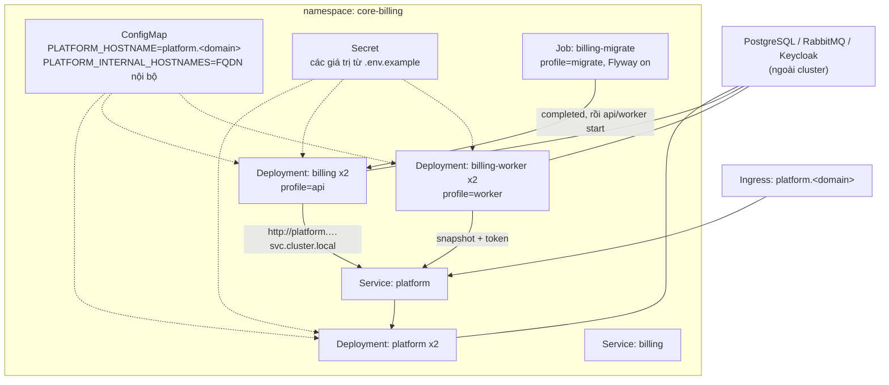

# Core Billing — thêm Kubernetes vào phase triển khai

Date: 2026-11-14 · Scope: bổ sung đường deploy Kubernetes song song `docker compose` cho Platform và Billing, trong
phạm vi của phase hiện tại · Status: advisory, no code written.

## Confirmed reframing

**Problem.** Repo chưa có manifest Kubernetes nào: `ops/` chỉ chứa caddy, keycloak, postgres init, rabbitmq users,
smoke và loadtest, và `grep -ril 'kubernetes\|kubectl\|helm'` trả về 0 kết quả. Trong khi đó `docker-compose.yml`
đang gánh bốn vai trò mà Kubernetes phải tái tạo bằng cách khác: tạo database và role
(`ops/postgres/init/00-databases.sh`), tạo broker user (`ops/rabbitmq/declare-users.sh`), thứ tự
`billing-migrate` → `billing` → `billing-worker`, và route theo Host qua Caddy.

Đồng thời, bất biến "tenant từ Host" mà cả Platform lẫn Billing dùng khiến mọi DNS nội bộ của Kubernetes trả 404:
Platform `TenantContextFilter.java:38-40` và Billing `SuiteTenantFilter.java:33` đều gọi
`resolveHost(request.getServerName())`, và chỉ `/actuator/health` được bypass. Ở local lỗi này bị che bởi network
alias `platform.localhost` và bởi việc sample tenant không nằm trong stack.

Khảo sát còn lộ ra một bug thật: `EnsurePlatformDomainUseCase.java:36-42` làm check-then-insert, `add()` trong
`JooqTenantDomainRepository.java:23-32` là insert thường, và `tenant_domains.hostname` có `unique`
(`V1__baseline.sql:51`). Compose chạy một replica nên không sao; Kubernetes chạy hai replica sẽ làm một pod chết lúc
startup vì vi phạm unique constraint.

**Project owner's decisions**

| Topic | Choice |
|---|---|
| Phạm vi deploy | Chỉ app: `platform`, `billing` (api), `billing-worker` |
| Hạ tầng | PostgreSQL, RabbitMQ, Keycloak là **external**, cấu hình qua env; không StatefulSet |
| Sample tenant | Không deploy — nó đại diện cho một app bên ngoài dùng credential tạo trước |
| Docker compose | Giữ **song song** như đường deploy hạng nhất, không bị thay thế |
| Kiểm chứng | Validate schema bằng `kubeconform`, không cần cluster trong CI |
| Xử lý Host nội bộ | Đăng ký nhiều hostname (không bypass filter, không tin header nội bộ) |

**Exact requirements**

1. `platform.tenancy.internal-hostnames` (list, mặc định **rỗng**) — Platform đăng ký mọi giá trị thành domain
   `PLATFORM`, idempotent.
2. Giữ `platform.<base-domain>` cho admin công khai; thêm DNS nội bộ cho Billing.
3. `PlatformBootstrap` chịu được ≥2 replica khởi động đồng thời.
4. Manifest cho `platform`, `billing`, `billing-worker`: Deployment, Service, ConfigMap, Secret, và một Job migrate.
5. Hạ tầng ngoài cluster, cấu hình qua env.
6. `tenant` không được deploy.
7. Job một lần cho migrate Billing (`profile=migrate`) chạy trước khi api/worker rollout.
8. Validate schema bằng `kubeconform`, không cần cluster.
9. `docker compose` local chạy **không đổi hành vi**.

**Goals.** Có một đường deploy Kubernetes chạy được, dùng cùng một `app-boot.jar` và cùng `application.yml`, khác
biệt chỉ ở env và cách đóng gói thứ tự khởi động — để hai đường không trôi khỏi nhau về mặt code.

**Done means**

- `ops/k8s/` tồn tại với ba workload, Job migrate, ConfigMap và Secret template.
- `kubeconform -strict` exit 0 trên toàn bộ `ops/k8s/`.
- Test: hai hostname đăng ký → cả hai resolve `RequestScope.platform()`; list rỗng → chỉ `platform.localhost` resolve.
- Test: đăng ký domain chạy hai lần liên tiếp không ném và để lại đúng một row.
- `./gradlew check` xanh ở `platform/` và `billing/`.
- `docker compose up -d --build --wait` + `suite-smoke.sh` + `isolation.sh` vẫn xanh, `git diff docker-compose.yml` rỗng.

**Non-goals.** StatefulSet cho PostgreSQL/RabbitMQ/Keycloak; deploy `tenant` và `web`; dựng cluster trong CI; bỏ
`docker compose`; đổi schema `tenant_domains`; `spring-cloud-kubernetes` discovery; Helm/Kustomize.

**Constraints.** Bất biến "tenant luôn từ host" giữ nguyên. `platform.localhost` vẫn phải hoạt động. `core-feign`
không đụng. Không đổi `contracts/`. Không đổi schema. Cùng một artifact cho cả hai đường, không có nhánh code riêng
cho Kubernetes.

## Preview of the target state



Before → after:

| | Docker Compose (giữ nguyên) | Kubernetes (mới) |
|---|---|---|
| Deploy | `docker compose up` | `kubectl apply -f ops/k8s/` |
| Platform hostname | `platform.localhost` | `platform.<domain>` + FQDN nội bộ |
| `internal-hostnames` | **rỗng** (mặc định) | `[platform.<ns>.svc.cluster.local]` |
| Billing → Platform | `http://platform.localhost:8080` (alias) | `http://platform.<ns>.svc.cluster.local` |
| Migrate | service `billing-migrate` | Job |
| Infra | container trong compose | external qua env |
| Kiểm chứng | `suite-smoke.sh` (CI có sẵn) | `kubeconform -strict` (CI mới) |

Hai thay đổi Java, không phải một: list hostname, và sửa race bootstrap. Cái thứ hai là bug có sẵn mà Kubernetes làm
lộ ra; bỏ qua thì `replicas: 2` sẽ làm pod crash.

## Verdict

Hướng đúng, nhưng có một điểm phải nói thẳng: **phần lớn giá trị của phase này không nằm ở manifest Kubernetes, mà ở
hai sửa đổi Java nhỏ mà Kubernetes làm lộ ra.** Nếu chỉ viết YAML rồi `kubectl apply`, sẽ gặp hai lỗi ngay: Platform
trả 404 cho FQDN nội bộ, và pod thứ hai crash lúc startup vì vi phạm unique constraint trên `tenant_domains`. Manifest
sẽ trông hoàn chỉnh nhưng stack không chạy.

Tin tốt: cả hai đều là sửa nhỏ, và cái thứ hai có sẵn convention trong repo — `onConflict(...).doNothing()` xuất hiện
ở tám chỗ (`JooqCustomerRepository.java:43`, `JooqPaymentRepository.java:40`, `JooqIncidentRepository.java:45`…).

## What you should do

1. **Thêm list hostname nội bộ.** `PlatformProperties.Tenancy` (hiện là `record Tenancy(String baseDomain, String
   platformHostname)` ở dòng 25) thêm `List<String> internalHostnames`; `PlatformBootstrap` lặp và gọi
   `ensurePlatformDomain` cho từng cái. Mặc định **rỗng** → compose không đổi.
2. **Sửa race bootstrap.** Đổi `EnsurePlatformDomainUseCase` sang upsert idempotent: insert với
   `onConflict(HOSTNAME).doNothing()`, rồi đọc lại khi insert không xảy ra. Dùng đúng pattern có sẵn.
3. **Viết `ops/k8s/`**: ConfigMap, Secret template (không commit giá trị), ba Deployment, hai Service, một Job
   migrate, Ingress cho admin host.
4. **Nối thứ tự khởi động.** Kubernetes không có tương đương `depends_on: service_completed_successfully`; dùng
   `initContainer` poll hoặc để api/worker tự chờ (chúng chạy với Flyway off nên chỉ cần schema có sẵn).
5. **Thêm bước CI `kubeconform -strict`** cho `ops/k8s/`, giữ `suite.yml` nguyên vẹn.
6. **Viết test** cho cả hai sửa đổi Java.
7. **Cập nhật `docs/runtime-profiles.md`** — hiện tài liệu chỉ mô tả `docker compose`.

## What you shouldn't do

- **Đừng đặt `internal-hostnames` mặc định bằng giá trị Kubernetes.** Nếu default là
  `platform.default.svc.cluster.local`, compose sẽ đăng ký domain lạ mỗi lần chạy — phá yêu cầu "compose không đổi".
  Mặc định phải là `[]`.
- **Đừng dùng Helm.** Manifest thuần là đủ; Helm thêm templating layer mà chưa có nhu cầu đa môi trường đã chứng minh.
- **Đừng đưa PostgreSQL/RabbitMQ/Keycloak vào StatefulSet.** Đã chốt external; StatefulSet là phần lớn khối lượng và
  toàn bộ rủi ro vận hành.
- **Đừng dùng `spring-cloud-kubernetes` discovery.** Nó phá tính "một jar chạy mọi nơi" mà yêu cầu "song song" vừa đặt
  ra — và Kubernetes Service DNS đã đủ.
- **Đừng bỏ service `billing-migrate` khỏi compose.** Hai đường song song; xoá một cái là phá acceptance criterion.
- **Đừng để Secret chứa giá trị thật trong git.** Template + `.gitignore`, hoặc `stringData` để trống có comment.
- **Đừng sửa `SuiteTenantFilter` để bypass Host cho `/internal/**`.** Đó là mở một đường tin cậy mới; list hostname
  giải quyết cùng vấn đề mà không đổi bất biến.
- **Đừng đổi `PLATFORM_TOKEN_ISSUER` sang DNS nội bộ.** Issuer phải là chuỗi công khai ổn định mà Billing verify; đổi
  nó sẽ làm mọi suite token bị từ chối, đúng bẫy trong journal `2026-11-14-fix-issuer-fallback-traps`.
- **Đừng bật `PLATFORM_TOKEN_ALLOW_EPHEMERAL_KEY` trên cluster.** Key ephemeral khác nhau mỗi pod, nên token một pod
  ký sẽ fail ở pod khác; `SecurityConfiguration` đã ném `IllegalStateException` cho trường hợp này.

## What could be better / more efficient

| # | Việc | Effort | Tại sao |
|---|---|---|---|
| 1 | `onConflict().doNothing()` cho bootstrap | Rất thấp | Pattern có sẵn; chặn crash pod |
| 2 | `internalHostnames` list | Thấp | Mở khoá toàn bộ đường nội bộ |
| 3 | ConfigMap + Secret + ba Deployment | Trung bình | Phần lớn khối lượng YAML |
| 4 | Job migrate + thứ tự khởi động | Trung bình | Dễ làm sai; đây là chỗ compose dễ hơn Kubernetes |
| 5 | Ingress | Thấp | Chỉ cần nếu muốn truy cập từ ngoài cluster |

Ghi chú: #4 là chỗ Kubernetes khó hơn compose đáng kể. Compose có
`depends_on: service_completed_successfully`; Kubernetes không có tương đương trực tiếp.

## My take and how to get there

Làm theo thứ tự **Java trước, YAML sau**. Manifest không thể đúng nếu code chưa đúng, và nếu làm ngược lại sẽ không
phân biệt được lỗi YAML với lỗi 404 hay lỗi constraint.

1. Sửa `EnsurePlatformDomainUseCase` → upsert idempotent; chạy `./gradlew :apps:app-boot:check` ở `platform/`.
2. Thêm `internalHostnames` vào `PlatformProperties.Tenancy`, `PlatformBootstrap`, `application.yml`; viết test.
3. Viết `ops/k8s/` từng file: namespace, configmap, secret.example, platform deployment/service, billing
   deployment/service, billing-worker deployment, billing-migrate job, ingress.
4. `kubeconform -strict -summary ops/k8s/`.
5. Thêm bước CI; giữ `suite.yml` nguyên.
6. Cập nhật `docs/runtime-profiles.md` thêm mục Kubernetes.
7. Chạy lại `docker compose up -d --build --wait` + hai smoke script để chứng minh không hồi quy.

**Extensibility check.** Đường mở rộng khả dĩ: thêm service mới. Với cách này, thêm service = thêm một Deployment +
một Service + env trỏ DNS; `core-feign` không đổi, `internalHostnames` không đổi (chỉ service *được gọi* cần
hostname). Nếu sau này có môi trường thứ hai (staging/prod) với manifest gần giống nhau, đó là lúc Helm/Kustomize đáng
giá — hôm nay chưa có bằng chứng cho nhu cầu đó, nên đi manifest thuần và ghi lại điểm chuyển đổi.

## Benefits

- Hai đường deploy song song cùng một artifact và cùng `application.yml` — không có nhánh code riêng cho Kubernetes.
- Sửa một bug thật (race bootstrap) mà compose che mất vì chạy một replica.
- Bất biến "tenant từ Host" giữ nguyên vẹn; không mở đường tin cậy mới.
- Compose không đổi hành vi, nên CI hiện tại không bị ảnh hưởng.
- Thêm service mới sau này không phải sửa caller.

## Trade-offs

- **Hai đường deploy = hai thứ phải giữ đúng.** Mỗi config mới phải phản ánh ở `docker-compose.yml` **và**
  `ops/k8s/configmap.yaml`. Chi phí thật, và tăng theo thời gian.
- **Manifest thuần không có templating.** Staging/prod sẽ phải copy-sửa, dễ lệch. Chấp nhận được khi chỉ có một môi
  trường Kubernetes; sẽ đau khi có môi trường thứ hai.
- **Thứ tự migrate trên Kubernetes không có `depends_on` tương đương.** Phải tự dựng bằng initContainer hoặc retry, và
  dễ sai hơn compose.
- **Không có cluster trong CI → manifest chưa được chứng minh chạy thật.** `kubeconform` chỉ bắt lỗi schema, không bắt
  lỗi logic (sai tên env, sai port, thiếu secret key). Đây là khoảng trống đã biết và đã được chấp nhận.
- **Khuyến nghị dừng đúng khi** có môi trường Kubernetes thứ hai, hoặc cần CI chứng minh rollout. Lúc đó chi phí
  chuyển sang Helm/Kustomize + kind cluster là công việc riêng, không phải viết lại manifest từ đầu.

## Unverified

- **Relaxed binding của `List<String>` trong record `@ConfigurationProperties`.** Chưa chạy Spring Boot thật để xác
  nhận `PLATFORM_INTERNAL_HOSTNAMES=a,b` bind đúng. Xác nhận bằng cách khởi động với hai giá trị và kiểm tra
  `PlatformProperties`. Pattern `serviceClients: List<ServiceClient>` đã dùng list trong cùng record
  (`PlatformProperties.java:7`, canonical constructor dòng 9-11), nên khả năng cao hoạt động.
- **Race thực sự gây crash hay chỉ log lỗi.** Đọc code cho thấy `ApplicationRunner` ném exception sẽ làm context fail
  và pod exit, nhưng chưa chạy hai replica thật để xác nhận. Xác nhận bằng `replicas: 2` trên local hoặc một test
  hai thread.
- **`UncommittedRace` có dùng được cho case này không.** Helper đó cần một statement block trên row lock
  (`platform/apps/app-boot/src/test/java/dev/ngb/platform/support/UncommittedRace.java:60-69`), còn check-then-insert
  không block theo cách đó; test race có thể phải viết khác (hai thread, assert không ném, một row).
- **Ingress controller.** Chưa khảo sát cluster đích; thiết kế giả định `ingressClassName: nginx`. Cần xác nhận.
- **Không có manifest nào để đối chiếu**, nên toàn bộ `ops/k8s/` là đề xuất mới, không phải sửa đổi file có sẵn.

## Work checklist

- [ ] `EnsurePlatformDomainUseCase`: insert `onConflict(HOSTNAME).doNothing()` + đọc lại khi không insert
- [ ] Test: gọi đăng ký hai lần liên tiếp → một row, không ném, event publish đúng một lần
- [ ] `PlatformProperties.Tenancy` thêm `List<String> internalHostnames` (mặc định `[]`)
- [ ] `PlatformBootstrap` đăng ký `platformHostname` + từng `internalHostnames`
- [ ] `application.yml`: `internal-hostnames: ${PLATFORM_INTERNAL_HOSTNAMES:}`
- [ ] Test: hai hostname → cả hai resolve `RequestScope.platform()`
- [ ] Test: list rỗng → chỉ `platformHostname` resolve
- [ ] `ops/k8s/namespace.yaml`, `configmap.yaml`, `secret.example.yaml`
- [ ] `ops/k8s/platform-{deployment,service}.yaml`
- [ ] `ops/k8s/billing-{deployment,service}.yaml`, `billing-worker-deployment.yaml`
- [ ] `ops/k8s/billing-migrate-job.yaml`, `ops/k8s/ingress.yaml`
- [ ] `.gitignore` chặn `ops/k8s/secret.yaml`
- [ ] CI: thêm bước `kubeconform -strict`
- [ ] `docs/runtime-profiles.md`: thêm mục Kubernetes
- [ ] `./gradlew check` ở `platform/`, `billing/`
- [ ] `docker compose up -d --build --wait` + `suite-smoke.sh` + `isolation.sh`

## Success metrics

- `kubeconform -strict -summary ops/k8s/` → exit 0, 0 invalid.
- `grep -r "platform.localhost" ops/k8s/` → chỉ xuất hiện trong ConfigMap/Ingress làm host công khai, không trong base
  URL của Billing.
- Test nhiều hostname pass; test đăng ký hai lần pass với đúng một row trong `tenant_domains`.
- `./gradlew check` xanh ở hai build; `suite-smoke.sh` exit 0.
- `git diff docker-compose.yml` rỗng sau toàn bộ thay đổi.

## Handoff brief

```text
Objective: Thêm đường deploy Kubernetes song song docker compose cho platform + billing api/worker, và sửa hai điểm mà Kubernetes làm lộ ra: Platform chỉ nhận một hostname, và bootstrap tạo domain không idempotent.
Done means: ops/k8s/ có namespace, ConfigMap, Secret template, ba Deployment (platform, billing, billing-worker), hai Service, Job billing-migrate, Ingress; kubeconform -strict exit 0 trên toàn bộ; platform.tenancy.internal-hostnames tồn tại với mặc định rỗng nên docker compose không đổi hành vi (git diff docker-compose.yml rỗng); PlatformBootstrap đăng ký platformHostname + mọi internalHostnames; EnsurePlatformDomainUseCase dùng onConflict(HOSTNAME).doNothing() nên chạy hai lần để lại đúng một row và không ném; test chứng minh hai hostname đều resolve RequestScope.platform() và list rỗng chỉ đăng ký platformHostname; ./gradlew check xanh ở platform và billing; ops/smoke/suite-smoke.sh và ops/smoke/isolation.sh exit 0 sau docker compose up -d --build --wait.
Out of scope: StatefulSet cho PostgreSQL/RabbitMQ/Keycloak (external qua env); deploy tenant và web; dựng cluster trong CI; Helm/Kustomize; spring-cloud-kubernetes discovery; đổi schema tenant_domains; bỏ service billing-migrate khỏi compose; bypass Host resolution cho path nội bộ.
Constraints: Bất biến "tenant luôn lấy từ host đã resolve" (SuiteActorResolver) giữ nguyên; platform.localhost phải tiếp tục hoạt động trên compose; core-feign không được sửa; không đổi contracts/; internal-hostnames mặc định phải rỗng để compose không đổi; cùng một app-boot.jar chạy cả hai đường, không có nhánh code riêng cho Kubernetes; PLATFORM_TOKEN_ISSUER và BILLING_PLATFORM_ISSUER giữ nguyên chuỗi công khai ổn định; PLATFORM_TOKEN_ALLOW_EPHEMERAL_KEY phải false trên cluster; không commit giá trị secret thật.
Stop and ask only if: lệch version Spring Boot 4.1.2 / Spring Cloud 2025.1.4 làm build hỏng mà không giải thích được; cần sửa core-suite hoặc SuiteTenantFilter (ngoài scope đã chốt); cần biết ingress controller hoặc domain thật ngoài cluster; cần thao tác phá huỷ hoặc ghi đè dữ liệu tenant_domains hiện có.
```
